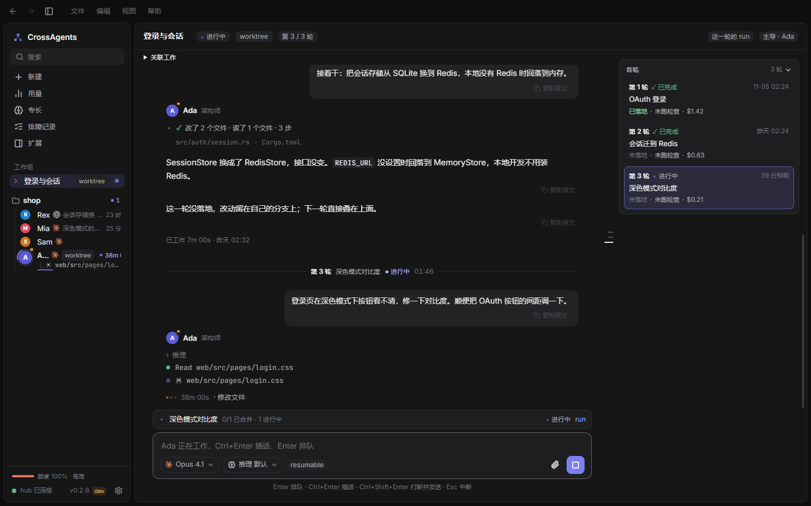
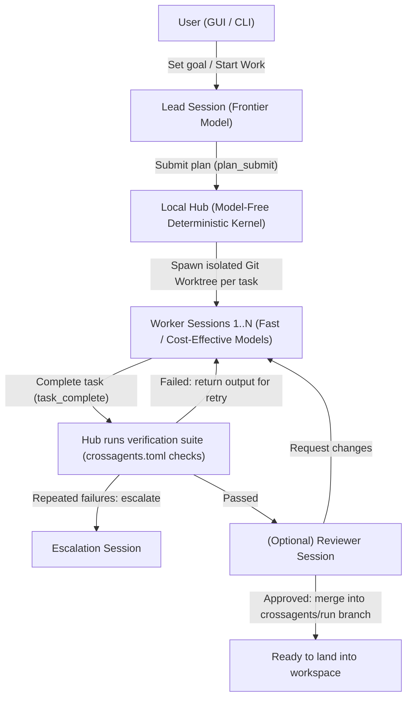

<div align="center">
  
  <h1>CrossAgents</h1>
  <p><strong>A Local-First Orchestration OS for Multi-Vendor Coding Agents</strong></p>
  <p>Strong models plan & review · Fast models build in isolated Git worktrees · The Hub runs deterministic checks</p>
  <p>
    <a href="README.md">简体中文</a> ·
    <a href="https://github.com/L1nkkkk/CrossAgents-releases/releases/latest">Download Releases</a> ·
    <a href="docs/DESIGN.md">Architecture</a> ·
    <a href="docs/AGENT-WORKSPACE.md">Workspace Model</a> ·
    <a href="docs/EXTENSIONS.md">Extensions</a>
  </p>
</div>

---

CrossAgents is a local-first multi-agent coding orchestrator and desktop workbench. It lets you combine coding agents across vendors and pricing tiers in the same repository: **use frontier models (Claude Opus / GPT-5 class) for architecture, task decomposition, and code review, while dispatching cost-effective or separate-quota models to write code in parallel**.

Every task runs in its own isolated `git worktree`. When an agent finishes a task, the local `hub` runs your project's verification commands itself—automatically sending failures back for retry, escalating to stronger models when needed, and merging verified changes into an integration branch for your final approval.



## Key Features

- **Peer Agents & Dynamic Responsibilities**: Agents are equal collaborators in a project rather than locked into rigid identity labels. The same agent session can chat with you daily, lead a multi-task work run (`Lead`), implement a task (`Worker`), or review another agent's diff (`Reviewer`).
- **Git Worktree Isolation & Deterministic Verification**: The `hub` contains no LLM of its own—it enforces deterministic scheduling, isolation, and verification. Each task gets a dedicated `git worktree`, runs worktree bootstrap commands (`setup`), and passes path-filtered verification suites (`checks`) declared in [`crossagents.toml`](crossagents.toml).
- **Persistent Agent Hosts & Zero-Downtime Takeover**: Each agent runs inside a dedicated `runtime-host` process that outlives both the GUI and the `hub`. Restarting or upgrading the `hub` never interrupts an active coding turn; the new `hub` re-adopts running hosts via local token handshakes and replays buffered output (see [Process Supervision](docs/PROCESS-SUPERVISION.md)).
- **Native Vendor Drivers + Universal ACP Fallback**: First-class native drivers for major CLIs unlock session resumption, branching, rollback, structured per-turn diffs, and live quota inspection. Any other agent speaking [ACP (Agent Client Protocol)](https://agentclientprotocol.com) plugs in via configuration without code changes.
- **Multi-Account & Cross-Subscription Quota Management**: Bind multiple accounts per vendor with isolated config directories and credentials. Inspect live rate-limit windows, reset timers, and credit balances, and track token/cost breakdowns by role, model, agent, or run.
- **Built-in Controlled Browser & Human Takeover**: Through built-in GUI browser tabs and Chrome bridge integration, agents can invoke `browser_*` tools to read accessibility snapshots, click, type, and take screenshots. All web content is wrapped with prompt-injection boundaries, and humans can take over or hand back any tab at any time (see [Browser Docs](docs/BROWSER.md)).
- **Zero-Compile Hot-Reloadable Extensions**: Drop scripts or manifests into `~/.crossagents/extensions/` to add custom tools, system prompt appendices, streaming rules, event hooks, background services, and custom GUI panels—backed by content-addressed snapshots (see [Extensions Docs](docs/EXTENSIONS.md)).
- **Project Expertise & Lessons Learned**: Built-in `Expertise` profiles and `Lessons` troubleshooting records allow subsequent agents to inherit architectural conventions and past debugging insights automatically.

## Supported Agent Drivers

| Plugin / Vendor | Default Driver | Integration & Capabilities |
|---|---|---|
| **Claude Code** | `claude-native` | `claude -p` (`stream-json` control protocol); auto-discovers `PATH`, `~/.local/bin/claude`, or bundled desktop binary |
| **Codex** | `codex-native` | `codex app-server` protocol; auto-discovers `PATH` or desktop binary, supports multi-account login & live quota queries |
| **Gemini CLI** | `gemini-native` | Native session & streaming driver; can also be switched to `--experimental-acp` via `acp-generic` |
| **Cursor CLI** | `cursor-native` | Native integration with Cursor CLI sessions, permission controls, and workspace operations |
| **Antigravity CLI** | `antigravity-native` | Connects to `agy` (supports Google AI Pro / Ultra personal account login and models) |
| **CodeBuddy / With** | `codebuddy-native` / `with-native` | Supports Tencent CodeBuddy CLI (including [CN / i18n site isolation](docs/CODEBUDDY-SITES.md)) and With CLI |
| **Any ACP Agent** | `acp-generic` | Any agent implementing [ACP](https://agentclientprotocol.com) (e.g., Goose) via `config.toml` or plugin manifests |

## Download & Installation

Prebuilt installers are published on [CrossAgents-releases](https://github.com/L1nkkkk/CrossAgents-releases/releases/latest):

| Platform | Package | Notes |
|---|---|---|
| **Windows (x64)** | `CrossAgents-Setup-<version>.exe` | **Recommended**. Bundles a matching `hub` binary, starts/upgrades it automatically on launch, and supports in-app auto-updates |
| **macOS (Apple Silicon)** | `CrossAgents-<version>-arm64.dmg` / `.zip` | Desktop GUI client (ad-hoc signed); connects to a locally built `hub` or a remote `hub` (see [macOS Install Guide](docs/INSTALL-MAC.md)) |
| **macOS (Intel) / Linux** | Build from source | See [Building from Source](#building-from-source) below |

## Quick Start

### Option 1: Desktop GUI (Recommended)

On Windows, launch CrossAgents directly—the bundled `hub` starts in the background automatically:

1. **Add Accounts & Teammates**: Add your Git repository in the sidebar, follow the guided flow to connect your Claude Code, Codex, or Gemini accounts, and create agent teammates (e.g., `Leo` on a frontier model, `Iris` on a fast coding model).
2. **Chat or Start a Work Run**:
   - **Direct Chat**: Click any teammate under your project to discuss code or make quick edits. Every turn displays a file-change summary, with per-turn diffs, commit graphs, and file trees available in the right-hand inspector.
   - **Orchestrated Work**: Ask a teammate to start a Work run or create one directly. The lead agent analyzes the repo, proposes a task plan (or executes in-place when decomposition isn't needed), dispatches tasks across teammates in isolated worktrees, verifies each task, and lands the result back into your workspace.
3. **Unified Inbox ("Needs You")**: The top of the sidebar collects all pending plan approvals, clarifying questions, and permission prompts in one place.

### Option 2: Command-Line Interface (CLI)

Use the interactive setup wizard to check your environment, sign in, inspect quotas, and register teammates:

```sh
# Guided Codex onboarding (env check → account selection/login → quota check → model pick → agent creation)
crossagents setup codex
```

Or start the `hub` and orchestrate runs manually:

```sh
# 1. Start the background hub
crossagents hub start

# 2. Register agent collaborators in your Git repository
crossagents agent add leo  --plugin claude --model opus  --cwd ~/proj
crossagents agent add iris --plugin claude --model haiku --cwd ~/proj

# 3. Start an orchestrated run (leo leads planning, iris executes tasks in parallel)
crossagents run "Add OAuth2 login and integration tests" --planner leo --worker iris

# 4. Inspect, approve, and track progress
crossagents run show <run-id>          # Review the submitted task plan
crossagents run approve <run-id>       # Approve plan to dispatch worktrees, verify, and merge
crossagents run show <run-id> -v       # Track task states; -v shows verification output & diffs

# 5. Merge the verified integration branch into your working branch
git merge crossagents/<run-id>
```

#### Common CLI Commands

```sh
# Direct interaction & turn diffs
crossagents send leo "Explain the scheduler lock design" --wait --file docs/DESIGN.md
crossagents attach leo                              # Live interactive terminal attachment
crossagents session diff leo --turn 3               # View full git diff produced by turn #3

# Inspect Work groups and multi-round history
crossagents work ls
crossagents work show <work-id>

# Advanced orchestration flags
crossagents run "Refactor database layer" --planner leo --worker iris \
  --reviewer orion \                                # Require code review by orion after checks pass
  --escalate leo \                                  # Escalate to leo in the same worktree after repeated failures
  --max-parallel 3 \                                # Max concurrent tasks (overlapping file scopes serialize automatically)
  --continue-run                                    # Enable bounded automatic wakeups when stalled

# Multi-account & token usage
crossagents account ls
crossagents account add codex-work                  # Create an isolated vendor account profile
crossagents account login codex-work                # Sign in via browser
crossagents account status codex-work               # Live plan, rate-limit windows, reset times & balance
crossagents usage --by model                        # Breakdown usage by role / model / agent / run

# Observability & troubleshooting
crossagents hub status                              # Inspect background runtime hosts, active sessions & errors
crossagents events --follow                         # Stream live SSE events
crossagents events --log                            # Read persisted daily JSONL event logs (works when hub is stopped)
crossagents lessons ls                              # Browse recorded project troubleshooting lessons
```

Every CLI command supports `--json` for structured machine-readable output.

## How It Works



1. **The Hub Does Not Think—It Enforces Rules**: All reasoning, planning, and code review happen inside agent sessions. The `hub` manages Git worktrees, mounts role-scoped MCP collaboration tools, executes verification commands, and drives the state machine.
2. **Self-Describing Repository Checks (`crossagents.toml`)**: Place a `crossagents.toml` at your repository root to declare per-worktree bootstrap commands (`setup`) and pre-merge verification checks (`checks`, triggered conditionally by changed `paths`):

```toml
[run]
setup = [
    { command = "npm ci", dir = "apps/gui", paths = ["apps/gui/package.json"] },
]
checks = [
    { command = "cargo test --workspace", paths = ["crates", "Cargo.toml"] },
    { command = "npm --prefix apps/gui run typecheck", paths = ["apps/gui"] },
]
timeout_secs = 1800
```

3. **Three-Tier Credentials & Local Security Boundary**: The `hub` binds strictly to `127.0.0.1` by default. API access is partitioned into `read`, `write`, and `admin` credentials. Each agent session receives a scoped token restricted to `/v1/me*` collaboration endpoints, preventing privilege escalation. The Tauri desktop webview communicates with its Rust backend through an explicit method-and-path allowlist, keeping tokens out of the webview context (see [API Auth & Access Levels](docs/API-AUTH.md)).

## Global Configuration & Custom Plugins

Local state and configuration live under `~/.crossagents/` (override with `CROSSAGENTS_HOME`). Configure ports, override binary paths, or register ACP agents in `~/.crossagents/config.toml`:

```toml
[hub]
port = 7420

# Override built-in plugin binary path (auto-detected if omitted)
[plugins.claude]
native_command = ["C:/tools/claude.exe"]

# Switch a built-in plugin to the generic ACP driver
[plugins.gemini]
command = ["gemini", "--experimental-acp"]
driver = "acp-generic"
```

You can also register custom ACP agents via directory manifests at `~/.crossagents/plugins/<name>/plugin.toml`:

```toml
name = "my-agent"
protocol = "acp"
command = ["./bin/my-agent", "--acp"]
models = ["fast", "smart"]
```

> **Windows Proxy Note**: Claude Code does not read the Windows system proxy by default. When `HTTPS_PROXY` is unset in the `hub` environment, `hub` automatically forwards the Windows system proxy to child agent processes (excluding loopback addresses).

## Building from Source

### Prerequisites

- **Rust Toolchain**: Latest stable Rust (`cargo`, `rustfmt`, `clippy`)
- **Node.js**: Node.js 20+ and `npm` (for `apps/gui`)
- **Git**: 2.30+ (with `git worktree` support)

### Build & Run

```sh
# 1. Build CLI and Hub
cargo build --release
# Binary is produced at target/release/crossagents (or crossagents.exe)

# 2. Run the Desktop GUI in development mode (Tauri)
cd apps/gui
npm install
npm run tauri:dev          # Launch Tauri dev window with hot reload
npm run preview:mock       # Preview UI in browser with built-in mock scenarios (no hub required)
npm run tauri:bundle       # Package Tauri desktop application with bundled hub
```

### Testing

The workspace includes a programmable mock agent (`crates/mock-agent`) that exercises the full orchestration pipeline—planning, worktree dispatch, verification retries, merges, and `hub` restart takeover—without requiring any LLM API keys or external accounts:

```sh
cargo fmt --check
cargo clippy --workspace --all-targets -- -D warnings
cargo test --workspace

# Frontend typecheck and unit tests
npm --prefix apps/gui run typecheck
npm --prefix apps/gui test
```

When modifying shared API types in `crates/api-types`, run `cargo test -p crossagents-api-types` to regenerate TypeScript bindings under `bindings/`.

## Architecture & Design Docs

- [System Architecture (DESIGN.md)](docs/DESIGN.md): Control plane vs. execution plane, state machines, and driver traits
- [Peer Agents & Project Sidebar (AGENT-WORKSPACE.md)](docs/AGENT-WORKSPACE.md): Dynamic task responsibilities and workspace navigation
- [Session-First Workflow (SESSION-FIRST.md)](docs/SESSION-FIRST.md): Bridging conversational sessions with multi-round orchestrated runs
- [Process Supervision & Takeover (PROCESS-SUPERVISION.md)](docs/PROCESS-SUPERVISION.md): `runtime-host` lifecycle, output buffering, and Windows Job Objects
- [Extension System (EXTENSIONS.md)](docs/EXTENSIONS.md): Zero-compile tools, prompts, rules, hooks, services, and GUI panels
- [Built-in Browser (BROWSER.md)](docs/BROWSER.md): GUI browser tabs, Chrome bridge, prompt-injection wrapping, and human takeover
- [API Auth & Access Control (API-AUTH.md)](docs/API-AUTH.md): Three-tier credentials, desktop allowlist, and endpoint matrix
- [Stall Recovery & Continuation (CONTINUATION.md)](docs/CONTINUATION.md): Bounded automatic wakeups for unattended runs
- [Multi-Node & Device Pairing (MULTI-NODE.md)](docs/MULTI-NODE.md): Cross-device pairing, NAT traversal, and remote hub architecture

## License

Licensed under the [Apache License 2.0](LICENSE). See [NOTICE](NOTICE) for copyright details.
