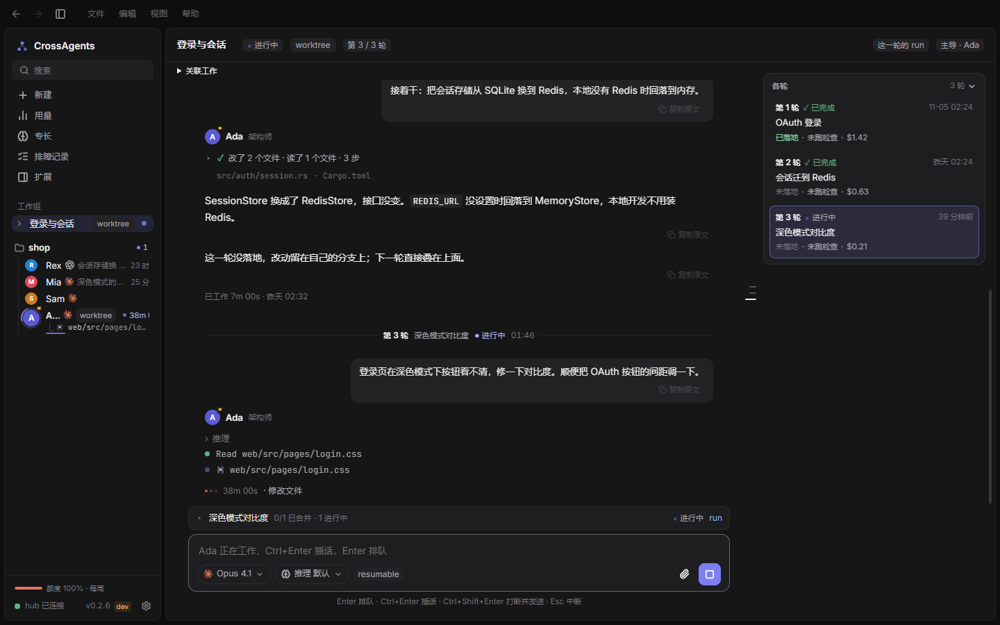
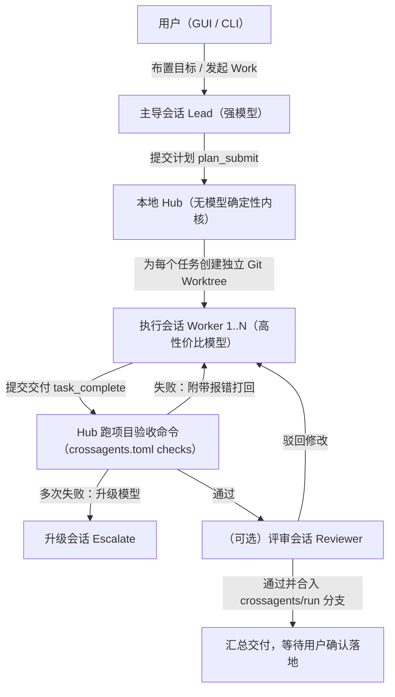

<div align="center">
  
  <h1>CrossAgents</h1>
  <p><strong>面向多厂商 Coding Agent 的本地编排操作系统</strong></p>
  <p>强模型统筹拆解与代码审查 · 多模型在独立 Git Worktree 中并行实现 · Hub 亲自执行验收命令</p>
  <p>
    <a href="README.en.md">English</a> ·
    <a href="https://github.com/L1nkkkk/CrossAgents-releases/releases/latest">下载安装包</a> ·
    <a href="docs/DESIGN.md">架构设计</a> ·
    <a href="docs/AGENT-WORKSPACE.md">工作区与协作模型</a> ·
    <a href="docs/EXTENSIONS.md">扩展开发</a>
  </p>
</div>

---

CrossAgents 是一个本地优先的多 Agent 编码编排器与桌面工作台。你可以把不同厂商、不同价位的 Coding Agent 组合进同一个项目：**用强模型负责架构设计、任务拆解与代码评审，用高性价比或不同订阅额度的模型并行写代码**。

每个子任务在各自隔离的 `git worktree` 中独立执行，完成后由本地 `hub` 亲自运行项目配置的测试与构建验收命令；验收失败自动打回重试，通过后合入集成分支，最终由你决定是否落入主分支。



## 核心特性

- **平等 Agent 与动态职责**：Agent 是项目中的平等协作者，不再受限于死板的固定身份标签。同一个 Agent 既可以与你日常对话，也可以在一次工作（Work / Run）中担任主导（Lead）、执行（Worker）或评审（Reviewer）。
- **Worktree 隔离与确定性验收**：`hub` 本身不包含大模型，只做确定性的调度、隔离与验收。每个任务独占 `git worktree`，通过项目根目录的 [`crossagents.toml`](crossagents.toml) 自动执行新工作区初始化（`setup`）与按改动路径触发的验收检查（`checks`）。
- **进程常驻与无感热接管**：Agent 运行在独立的 `runtime-host` 宿主进程中，生命周期独立于 `hub` 与桌面端。`hub` 重启或升级时不会中断正在执行的编码轮次，新 `hub` 启动后通过本地令牌握手自动接管宿主并补发缓存输出（详见 [进程监督设计](docs/PROCESS-SUPERVISION.md)）。
- **多厂商原生驱动 + ACP 协议兜底**：主力 Agent 走各自的原生控制协议，支持会话恢复、分叉、回滚、结构化 Diff 与实时额度查询；其余 Agent 通过 [ACP (Agent Client Protocol)](https://agentclientprotocol.com) 接入，零代码扩展新工具。
- **多账号与跨订阅额度统筹**：同一厂商可绑定多个独立账号（独立配置目录与凭证隔离），实时查看套餐窗口、重置时间与余额，按角色、模型、项目或日期统计 Token 与开销。
- **内置受控浏览器与人机接管**：桌面端内置浏览器标签与 Chrome 桥接支持，Agent 可调用 `browser_*` 工具读页面无障碍树、点击、填表、截图；所有网页返回内容自动包裹防提示词注入标记，且支持人类随时一键接管标签页（详见 [内置浏览器说明](docs/BROWSER.md)）。
- **免编译热加载扩展（Extensions）**：在 `~/.crossagents/extensions/` 下无需编译即可为 Agent 挂载自定义工具、附加提示词、流式规则、事件钩子、后台常驻服务与自定义 GUI 面板，基于内容哈希快照保障运行安全（详见 [扩展设计文档](docs/EXTENSIONS.md)）。
- **经验沉淀与故障复盘**：内置项目级与个人级经验库（Expertise）及踩坑记录（Lessons），让后续接手任务的 Agent 自动继承项目的架构偏好与排障经验。

## 支持的 Agent 驱动

| 插件 / 厂商 | 默认驱动 | 接入方式与能力说明 |
|---|---|---|
| **Claude Code** | `claude-native` | 基于 `claude -p` 的 `stream-json` 控制协议；自动查找 `PATH`、`~/.local/bin/claude` 或桌面端内置二进制 |
| **Codex** | `codex-native` | 基于 `codex app-server` 协议；自动查找 `PATH` 或桌面端内置二进制，支持多账号独立登录与实时额度查询 |
| **Gemini CLI** | `gemini-native` | 原生驱动支持会话管理与流式输出；也可在配置中切换为 `--experimental-acp` 走通用 ACP |
| **Cursor CLI** | `cursor-native` | 原生对接 Cursor CLI 会话、权限控制与工作区操作 |
| **Antigravity CLI** | `antigravity-native` | 对接 `agy`（支持 Google AI Pro / Ultra 个人账号登录与模型调用） |
| **Qoder CLI** | `qoder-native` | 基于 `qodercli -p` 的 `stream-json` 控制协议，支持会话恢复、跨目录续聊、分叉、逐次审批、上下文拆解与额度查询；保留 `qodercli --acp` 兜底 |
| **CodeBuddy / With** | `codebuddy-native` / `with-native` | 支持腾讯 CodeBuddy CLI（含[国内站与国际站独立登录](docs/CODEBUDDY-SITES.md)）与 With CLI |
| **任意 ACP Agent** | `acp-generic` | 任何实现 [ACP 协议](https://agentclientprotocol.com) 的 Agent（如 Goose 等），通过 `config.toml` 或插件目录即可接入 |

## 下载与安装

预编译安装包发布在 [CrossAgents-releases](https://github.com/L1nkkkk/CrossAgents-releases/releases/latest)：

| 平台 | 安装包 | 说明 |
|---|---|---|
| **Windows (x64)** | `CrossAgents-Setup-<版本>.exe` | **推荐**。内置同版本 `hub`，启动 GUI 时自动拉起并管理后台 `hub`，支持应用内自动更新 |
| **macOS (Apple Silicon)** | `CrossAgents-<版本>-arm64.dmg` / `.zip` | 桌面客户端（Ad-hoc 签名），可连接本机源码编译的 `hub` 或远程主机的 `hub`（见 [Mac 安装说明](docs/INSTALL-MAC.md)） |
| **macOS (Intel) / Linux** | 从源码构建 | 见下方「从源码构建」章节 |

## 快速开始

### 方式一：使用桌面端 GUI（推荐）

Windows 安装版打开即用，自带的 `hub` 会在后台自动启动：

1. **添加账号与成员**：在左侧栏添加你的项目仓库，通过引导绑定已登录的 Claude Code、Codex 或 Gemini 账号，创建团队成员（如用强模型创建 `Leo`，用快模型创建 `Iris`）。
2. **直接对话或发起 Work**：
   - **日常对话（Chat）**：点击项目下的任意成员直接交流、查代码或做小改动，每轮回复下方都会展示改动文件摘要，右侧工具栏可按轮次查看完整 Diff、Git 提交图与文件树。
   - **多 Agent 协同工作（Work）**：在对话中让主导成员发起 Work，或直接新建 Work。主导成员会先分析代码库并提交计划（或在不需拆解时直接原地完成），并行派发给团队成员在各自 worktree 中实现，通过验收后一键合入你的工作区。
3. **集中处理待办**：左侧栏顶部的「需要你」区域会汇总所有等待你审批计划、回答澄清问题或确认权限的事项，无需在多个会话间来回翻找。

### 方式二：使用命令行 CLI

如果你偏好终端或脚本自动化，可以使用一键引导快速完成环境检查、账号登录与成员初始化：

```sh
# 引导式配置 Codex（检查环境 → 选择/导入账号 → 登录 → 查看额度 → 选择模型 → 创建协作者）
crossagents setup codex
```

也可以手动启动 `hub` 并管理协同编排：

```sh
# 1. 启动后台 hub
crossagents hub start

# 2. 在你的 Git 仓库中登记 Agent 协作者
crossagents agent add leo  --plugin claude --model opus  --cwd ~/proj
crossagents agent add iris --plugin claude --model haiku --cwd ~/proj

# 3. 发起一次协同编排（leo 主导拆解与统筹，iris 并行实现）
crossagents run "为项目添加 OAuth2 登录与集成测试" --planner leo --worker iris

# 4. 查看计划、审批并跟踪进度
crossagents run show <run-id>          # 查看主导 Agent 提交的任务拆解计划
crossagents run approve <run-id>       # 批准计划，自动创建 worktree、派发、跑验收并合并
crossagents run show <run-id> -v       # 跟踪各任务状态；-v 查看验收命令输出与代码 diff

# 5. 将集成分支合入你的当前分支
git merge crossagents/<run-id>
```

#### 常用 CLI 命令速览

```sh
# 与单个 Agent 交互与查看改动
crossagents send leo "解释一下调度器的锁机制" --wait --file docs/DESIGN.md
crossagents attach leo                              # 实时终端附着交互
crossagents session diff leo --turn 3               # 查看某轮对话产生的完整代码 Diff

# 查看工作组（Work）与多轮迭代历史
crossagents work ls
crossagents work show <work-id>

# 编排控制选项
crossagents run "重构数据库层" --planner leo --worker iris \
  --reviewer orion \                                # 每个通过命令验收的任务先交由 orion 审查代码
  --escalate leo \                                  # 连续失败达到上限后，在原 worktree 升级给更强模型重做
  --max-parallel 3 \                                # 最大并行任务数（修改范围重叠的任务会自动串行化）
  --continue-run                                    # 开启停滞自动唤醒推进

# 账号与用量统计
crossagents account ls
crossagents account add codex-work                  # 新增独立隔离的厂商账号
crossagents account login codex-work                # 浏览器授权登录
crossagents account status codex-work               # 实时查询套餐、额度窗口、重置时间与余额
crossagents usage --by model                        # 按 role / model / agent / run 统计用量与开销

# 可观测性与排障
crossagents hub status                              # 查看后台宿主进程、活跃会话与异常摘要
crossagents events --follow                         # 实时订阅全部 SSE 事件流
crossagents events --log                            # 离线读取落盘的按日事件日志（hub 未运行时同样可用）
crossagents lessons ls                              # 查看项目积累的排障记录
```

所有 CLI 命令均支持添加 `--json` 输出结构化 JSON，方便被外部脚本或 Agent 组合调用。

## 工作流与架构原理



1. **Hub 不思考，只守规矩**：所有的代码理解、拆解与评审判断都在 Agent 会话中完成；`hub` 只负责管理 Git Worktree、挂载角色受限的 MCP 协作工具、执行命令验收与维护状态机。
2. **项目级自描述验收（`crossagents.toml`）**：在项目根目录放置 `crossagents.toml`，即可声明每个新 Worktree 创建后的依赖安装命令（`setup`），以及合入前必须通过的验收检查（`checks`，支持按改动路径 `paths` 条件触发）：

```toml
[run]
setup = [
    { command = "npm ci", dir = "apps/gui", paths = ["apps/gui/package.json"] },
]
checks = [
    { command = "cargo test --workspace", paths = ["crates", "Cargo.toml"] },
    { command = "npm --prefix apps/gui run typecheck", paths = ["apps/gui"] },
]
timeout_secs = 1800
```

3. **三级权限与本地安全边界**：`hub` 默认仅监听 `127.0.0.1`。API 划分为 `read` / `write` / `admin` 三级凭据；每个 Agent 会话仅持有作用域受限的会话 Token（只能访问 `/v1/me*` 工具接口），无法触达账号管理或越权操作其他会话。Tauri 桌面前端与 Rust 后端之间通过严格的方法与路径白名单通信，Token 永不暴露给前端页面（详见 [API 鉴权与分级说明](docs/API-AUTH.md)）。

## 全局配置与自定义插件

所有本机数据默认保存在 `~/.crossagents/`（可通过环境变量 `CROSSAGENTS_HOME` 更改）。可在 `~/.crossagents/config.toml` 中自定义端口、覆盖内置驱动命令或接入任意 ACP Agent：

```toml
[hub]
port = 7420

# 覆盖内置插件的二进制路径（不配置则自动探测）
[plugins.claude]
native_command = ["C:/tools/claude.exe"]

# 将内置插件切换为通用 ACP 驱动
[plugins.gemini]
command = ["gemini", "--experimental-acp"]
driver = "acp-generic"
```

也可以在 `~/.crossagents/plugins/<name>/plugin.toml` 下放置独立插件目录来注册新的 ACP Agent：

```toml
name = "my-agent"
protocol = "acp"
command = ["./bin/my-agent", "--acp"]
models = ["fast", "smart"]
```

> **Windows 代理提示**：Claude Code 默认不读取 Windows 系统代理。当 `hub` 环境中未设置 `HTTPS_PROXY` 时，会自动读取 Windows 系统代理并注入给子进程（本机回环地址除外）。

## 从源码构建与开发

### 环境要求

- **Rust 工具链**：最新稳定版 Rust（含 `cargo`、`rustfmt`、`clippy`）
- **Node.js**：Node.js 20+ 与 `npm`（用于构建 `apps/gui` 桌面端）
- **Git**：2.30+（需支持 `git worktree`）

### 构建与运行

```sh
# 1. 编译 CLI 与 Hub
cargo build --release
# 编译产物位于 target/release/crossagents（或 crossagents.exe），可加入 PATH

# 2. 启动桌面端 GUI 开发模式（Tauri）
cd apps/gui
npm install
npm run tauri:dev          # 启动 Tauri 桌面开发窗口（支持热重载）
npm run preview:mock       # 无需启动 hub，在浏览器中使用内置 Mock 场景预览界面与交互
npm run tauri:bundle       # 打包 Tauri 桌面客户端（含随附 hub）
```

### 运行测试

仓库内置了可编程的 Mock Agent（`crates/mock-agent`），无需配置任何真实大模型 API Key 或外部账号，即可在本地完整跑通「规划 → 拆解 → Worktree 派发 → 验收打回 → 合并落地」以及「Hub 重启热接管」的端到端测试流水线：

```sh
cargo fmt --check
cargo clippy --workspace --all-targets -- -D warnings
cargo test --workspace

# 前端类型检查与单元测试
npm --prefix apps/gui run typecheck
npm --prefix apps/gui test
```

若修改了 `crates/api-types` 中的前后端共享数据结构，运行 `cargo test -p crossagents-api-types` 会自动将最新的 TypeScript 类型定义重新生成到 `bindings/` 目录。

## 深入了解设计文档

- [总体架构设计 (DESIGN.md)](docs/DESIGN.md)：微内核控制面与执行面分离、状态机与协议设计
- [平等 Agent 与项目工作区 (AGENT-WORKSPACE.md)](docs/AGENT-WORKSPACE.md)：去固定角色化、职责指派与侧栏信息架构
- [会话优先与工作流设计 (SESSION-FIRST.md)](docs/SESSION-FIRST.md)：日常对话（Chat）与多轮协同工作（Work）的衔接
- [进程监督与热接管 (PROCESS-SUPERVISION.md)](docs/PROCESS-SUPERVISION.md)：`runtime-host` 守护、断线缓存补发与 Windows Job Object 进程树隔离
- [免编译扩展系统 (EXTENSIONS.md)](docs/EXTENSIONS.md)：工具、提示词、事件响应、后台服务与 GUI 扩展规范
- [内置受控浏览器 (BROWSER.md)](docs/BROWSER.md)：GUI 浏览器与 Chrome 桥接、防注入包裹与人工接管机制
- [API 权限分级与安全边界 (API-AUTH.md)](docs/API-AUTH.md)：三级 Token 体系、桌面端路由白名单与接口清单
- [停滞恢复与持续推进 (CONTINUATION.md)](docs/CONTINUATION.md)：无人值守运行时的自动唤醒与推进策略
- [多节点与跨设备互联 (MULTI-NODE.md)](docs/MULTI-NODE.md)：设备配对、内网穿透与远程 Hub 架构设计

## 许可证

本项目基于 [Apache License 2.0](LICENSE) 开源，版权声明详见 [NOTICE](NOTICE)。
