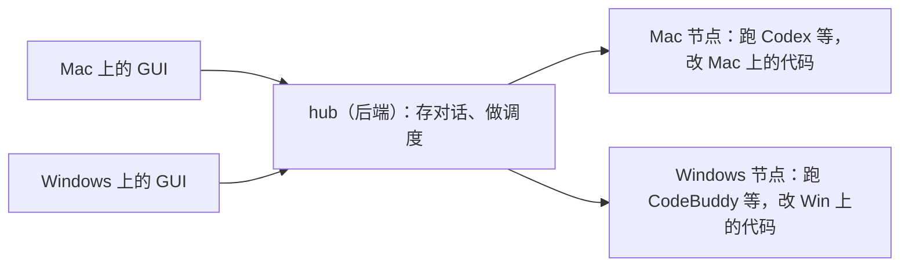
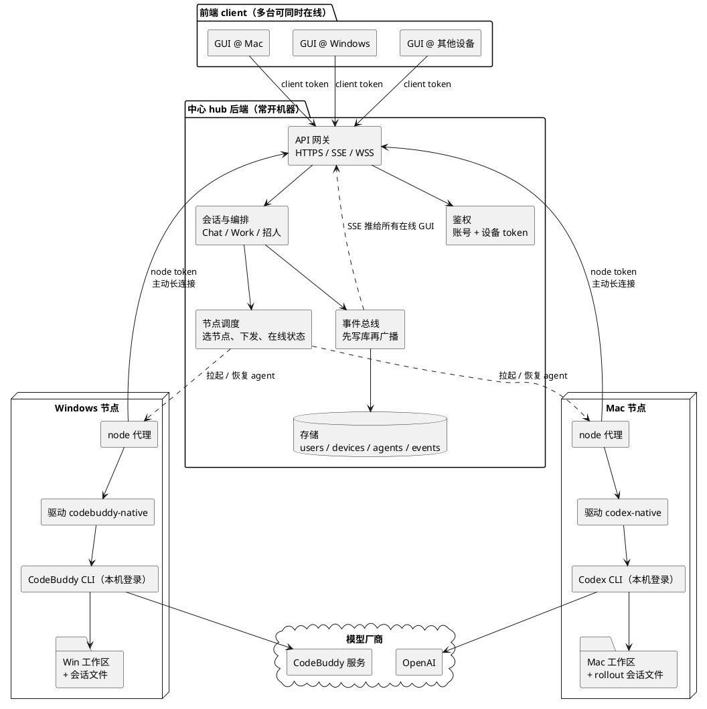
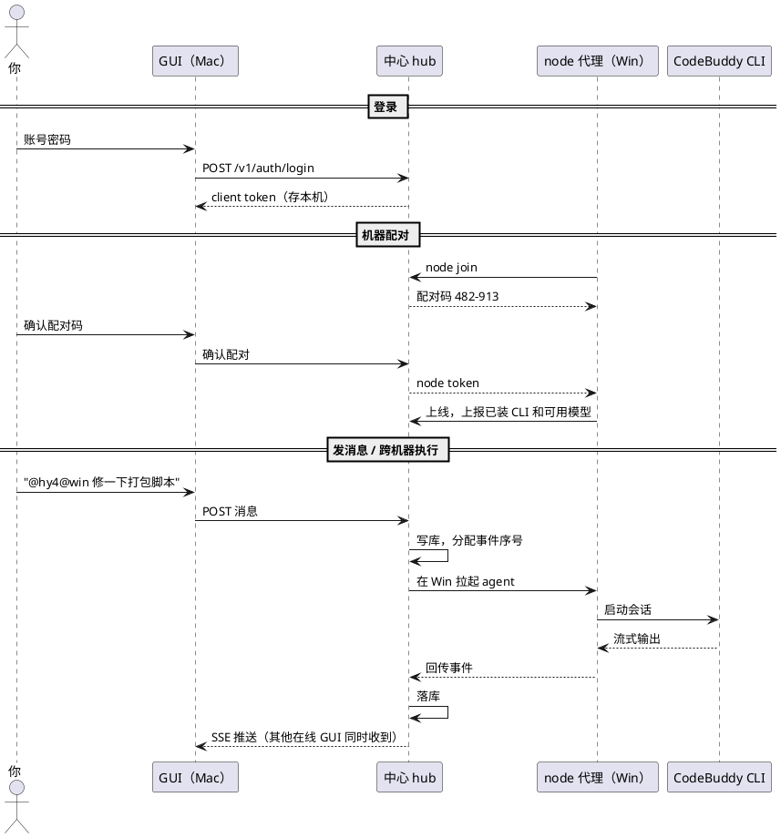
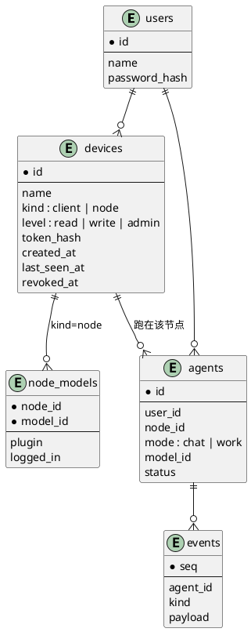

# CrossAgents 多节点设计（草稿）

> 状态：草稿，待打磨。放开 [DESIGN.md](DESIGN.md) §1.2 中「跨主机、多用户、设备配对」这条非目标。A 阶段远程 GUI 走 SSH 隧道（2026-11-08 定：人说按推荐来（run 84848059））。A1 设备与 token 已完成（2026-11-08，`9f8a07d`、`eeac7b7`；设计 `944922b`）。
> §11 第 2、3 条已定（连通方式、Mac 是 GUI + 节点），第 1 条保留待定；第 10 条（B1 节点怎么连中心）仍待定。其余标「待定」的地方还没有结论，见 §11。

## 0. 产品形态

CrossAgents 是"自己的 ChatGPT 桌面端"：交互像 ChatGPT（侧栏对话列表、Chat / Work 两种模式），背后干活的是你各台机器上的编程 agent（Codex、CodeBuddy、Claude），它们能互相招人协作，并在你自己的代码目录里改代码。任何设备打开 GUI 看到的都是同一份对话和同一组 agent。

| 阶段 | 形态 | 能做什么 |
|---|---|---|
| 现在 | 单机：GUI、hub、agent 都在 Windows | 在 Windows 上用 Chat 和 Work |
| A | 远程 GUI：Windows 当中心，Mac 的 GUI 连过来 | 在 Mac 上操作 Windows 上的对话，agent 仍在 Windows 跑 |
| B | 多节点：每台机器都能跑 agent，hub 统一调度 | 在 Mac 上开发 Windows 项目，跨机器招人 |
| 以后 | hub 迁到常开的云服务器，只当中心 | 任一客户端关机都不影响编排 |

## 1. 目标

- 多台设备看到同一份对话：在 Mac、Windows 或其他设备上打开 GUI，侧栏、转录、实时输出都一样。
- 跨机器执行：在一台机器上操作，让 agent 在另一台机器上跑，例如在 Mac 上开发 Windows 的东西。
- 跨机器协作：一台机器上的 agent 可以招另一台机器上的 agent（`@codex@win`），由中心统一调度。
- 全程托管不因客户端下线而中断：合上笔记本不影响编排和别的机器上的 agent。

### 1.1 非目标（本阶段）

- 跨机器共享文件系统。每个 agent 只碰自己节点的工作区，跨机器交接代码只走 git。
- 跨节点迁移会话。agent 创建后固定在一个节点上（CLI 原生会话文件在那台机器上）。
- 一个 Work run 横跨多个节点。第一版的 run 整体放在一个节点上，跨节点只用于 Chat 里招帮手。
- 多用户注册、团队共享、OAuth 登录。数据结构预留，界面不做。
- 远程代登录 CLI 账号。各节点的 Codex / CodeBuddy / Claude 在本机登录。

## 2. 方案选择

比较过三种拓扑：

| | 固定中心 hub + 节点 | 中心随人走 | 每台都是 hub，互联 |
|---|---|---|---|
| 客户端下线后编排继续 | 是 | 否 | 否（run 归发起机器） |
| 历史只有一份 | 是 | 否，需要搬迁 | 否，分散在各机器 |
| 关机机器的历史可见 | 是 | 否 | 需要缓存副本 |
| 需要常开机器 | 中心一台 | 不需要 | 中转服务需要 |
| 分布式复杂度 | 低 | 高（选主、迁移、冲突） | 中（互联、缓存、中转） |

选固定中心：全程托管要求编排者常在线，而后两种方案为了解决连通和可见性，最终也需要一台常开的服务，不如直接让它当中心。

代价与对策：

- 中心挂了全部不可用。GUI 保留本机模式作为兜底，连不上中心时切回本机 hub 单干（§15）。
- 需要一台常开机器。涉及公司代码时放公司内网，不放外部云。

## 3. 总体结构

三层：前端 client（GUI，多台可同时在线）、后端（中心 hub，常开）、执行端（每台机器一个 node 代理）。同一台物理机可以既开 GUI 又跑 node，两者用不同权限的 token。

要点：

- hub 是唯一正本：对话、事件、agent 状态、协作关系都在中心的存储里。
- GUI 是无状态的壳：打开时拉列表和转录，之后靠 SSE 收实时事件。草稿、窗口布局等界面状态留在本地，不同步。
- 节点主动连 hub（反向长连接），不用开端口，不怕 NAT。hub 的指令都走这条连接下发。
- hub 不碰代码。代码和 CLI 原生会话文件留在节点上；hub 只存对话里出现的文本、diff 和命令输出。

## 4. 账号与设备

### 4.1 两层账号

- CrossAgents 账号：由 hub 管，决定你是谁、名下有哪些设备、能看到哪些对话。
- CLI 账号（Codex / CodeBuddy / Claude）：在每个节点本机登录，凭据不离开节点。hub 只知道「这个节点上哪些插件已安装、已登录、能用哪些模型」。
- 同一个 CLI 账号登录在两台机器上，hub 视为两个来源（`codex@mac`、`codex@win`），额度共用。厂商是否限制同时登录设备数未逐家核实（待定），被挤下线时在节点状态里显示。

### 4.2 设备

结论：A 阶段没有账号。一个 hub 可以有多个设备在线，每个设备各自一个 token，互不影响。设备归属哪个账号（`user_id`）随 A3（§9、§12）。

- 设备分两类：
  - `client`：GUI。能做什么按签发时的级别走：read / write / admin，默认 write（[API-AUTH.md](API-AUTH.md) §3）。签发和吊销设备是 admin。
  - `node`：执行端。B1 的目标是只能领取分配给自己的 agent、回传事件、上报能力，不能读其他对话。B1 的节点通道做出来之前，node token 对现有路由一律 403。
- token 形如 `cad_` 加 64 位 hex，库里只存 SHA-256，不用 JWT。吊销后下一次请求 401，已经打开的事件流和终端输出流在 5 秒内断开。在设置「设备」页吊销，或用 `crossagents device revoke`。

### 4.3 登录与配对

结论：A 阶段的远程 GUI 用 SSH 隧道配对，不走账号密码（2026-11-08 定：人说按推荐来（run 84848059））。hub 继续只听 `127.0.0.1`，GUI 只连本机转发出来的端口。账号密码登录挪到 A3（§12）。

- 远程 GUI（2026-11-08 已实现，`f6a956a`、`fec959c`；验收要实测，见 §14「怎么实测」）：用系统 OpenSSH。Windows 优先 `%SystemRoot%\System32\OpenSSH\ssh.exe`，没有再找 PATH 上的 `ssh`；其他系统用 PATH 上的 `ssh`。每次都带 `-o BatchMode=yes -o ConnectTimeout=10`，不改用户的 `StrictHostKeyChecking`，所以要口令或主机密钥还不认识就失败，stderr 原样给「连接」页（对话框以后做，[TODO.md](TODO.md) §八）。配对前先在中心上读 `~/.crossagents/hub.json`：先 `cat`，失败再 `type "%USERPROFILE%\.crossagents\hub.json"`，从里面拿端口和 hub 自己的 exe。中心上要跑的命令按这个顺序：用户在「高级」里填的 > hub.json 的 `exe`（不合规就不用）> PATH 上的 `crossagents`。然后跑 `<命令> device add <设备名> --json`。这条命令在中心本机执行，用的是中心的总 token（[paths.rs](../crates/hub/src/paths.rs) `Paths::token`）。token 只在 Electron 主进程：`safeStorage` 加密后和目标、设备名、设备 id、配对时间、本机端口、当前模式一起写在 `<userData>/remote.json`；加密不可用，或 Linux 上后端是 `basic_text`，就拒绝保存。渲染层拿不到 token。之后 `ssh -N -o ExitOnForwardFailure=yes -o ServerAliveInterval=15 -o ServerAliveCountMax=3 -L 127.0.0.1:<本机端口>:127.0.0.1:<中心端口>`（另带上面的 BatchMode 与 ConnectTimeout），GUI 只连本机端口。本机端口第一次选空闲端口并记住，之后沿用。断了按 1、2、5、10、30 秒退避重连，每次重连前重读 hub.json；hub 对设备 token 回 401 就停止重连，要求重新配对。认证交给 `~/.ssh/config` 与 ssh-agent。怎么连得到中心的 SSH，见 §14「SSH 隧道」。远程模式下不管理任何 hub，见 §13.3。选文件夹改成输入中心上的路径（[Home.tsx](../apps/gui/src/views/Home.tsx)）。
- 本机 GUI 仍用本机总 token，不经这套配对。设备的签发、列表、吊销见 §12 A1。
- 节点（B1）怎么连中心：待定（§11 第 10 条）。一条是经 SSH 隧道，Mac 可以复用上面这条 GUI 隧道；另一条是等 A3 开端口之后，在节点上运行 `crossagents node join <hub 地址>`，终端显示配对码，在已登录的 GUI 里确认，节点拿到 node token，之后开机自动连接。A 阶段不选。
- 账号密码登录属于 A3：`crossagents user add` 建账号，`/v1/auth/login` 换 token，不做注册页和找回密码。以后要接 GitHub、企业微信扫码，只换登录这一层。

## 5. 关键流程

## 6. 多端同时在线

- 看：每条事件先写库、分配全局序号，再推给所有订阅者，各端顺序一致。现有 `/v1/events` 已支持 `since` 与 `Last-Event-ID` 续传，远程 GUI 断线重连沿用即可。
- 发：每个 agent 一个收件队列，多端同时发消息按到达 hub 的顺序处理，沿用现有排队、撤回、`now` 插队。
- 审批：所有在线 GUI 都显示待审批；以先到 hub 的回答为准，其他端变为「已在 <设备名> 上处理」。
- 本地状态：草稿、选中项、窗口布局不同步。

## 7. 节点

### 7.1 职责划分

现有 drivers 拆成两半：

- 留在 hub：选节点、决定拉起 / 恢复 / 挂起、权限规则、事件落库与折叠、协作工具（MCP）的业务逻辑。
- 挪到 node：拉起 CLI 进程、驱动协议翻译（codex app-server、claude stream-json、codebuddy、ACP）、本机账号目录、工作区操作。

hub 与 node 之间是一条双向消息通道（WSS，待定），承载：

- hub → node：`open`、`resume`、`prompt`、`interrupt`、`suspend`、`shutdown`、`set_model`、权限回答、列目录 / 读文件等辅助请求。
- node → hub：统一会话事件（与现有 `Driver` 事件模型一致）、权限请求、能力与模型上报、心跳。

B1 还有三处跟着改：

- 内置终端：[terminal.rs](../crates/hub/src/terminal.rs) 的 PTY（`Terminals::create`、`default_shell`）现在跑在 hub 那台机器上，`TerminalInfo.node` 与 `CreateTerminalRequest.node` 已为跨节点预留；要改成在拥有工作区的节点上开，GUI 才能操作那台机器上的 shell。
- 节点在 macOS 上开机自启就是 launchd 的 LaunchAgent，拿到的是最小 PATH（[MACOS.md](tasks/MACOS.md) §4）→ 节点启动时用登录 shell 取一次环境（`$SHELL -ilc env`，带超时）。
- 节点机器上的 GUI 管的是本机 node（单干时是本机 hub + 内置节点，§15）：[localHub.cts](../apps/gui/electron/localHub.cts) 的 `manageLocalHub` / `run` 那套从「管 hub」改成「管 hub 或 node」，§13.3 相应补充。

### 7.2 协作工具的接入

agent 的 MCP 现在连本机 hub（`crossagents mcp`，带会话令牌）。跨机器后有两种做法（待定）：

- node 在本机起一个 MCP 端点，转发到 hub。agent 侧配置不变，推荐。
- agent 直连中心 hub 的 MCP。少一跳，但节点上每个会话都要能访问中心地址。

### 7.3 模型与选节点

- 模型 id 带节点名：`codex@mac`、`hy4@win`。`@` 菜单按节点分组。
- 不指定节点时，hub 在已安装、已登录该插件的在线节点里挑：优先发起方所在节点，其次空闲的。
- 节点未安装或未登录的插件不提供模型，招人时跳过（与修 Atlas 时的 `installed()` 规则一致）。

### 7.4 掉线

- 节点掉线：其上 agent 标为「节点离线」；CLI 进程照常跑，事件在节点本地缓存，重连后按序补发。缓存上限与过期处理待定。
- 中心掉线：节点侧同上；GUI 显示连接断开，可切回本机模式（§15）。
- 节点重启：hub 下发 `resume`，节点用原生会话 id 恢复。

### 7.5 存储分布与负载

- 对话正本只在中心，不做分片或多副本强一致：个人用量几年也就几 GB，个人机器常休眠，强一致集群反而更容易不可用。
- 附件（截图、构建产物、日志、大 diff）留在节点，hub 只存引用（节点、路径、大小、哈希），GUI 打开时按需拉取；节点离线时附件不可看，文字记录不受影响。
- 节点保留自己 agent 的追加事件日志（离线缓存补发后不删），兼作 hub 灾备重建来源。
- 负载：hub 只做转发和存储，内存几十 MB，CPU 基本空闲；重的是节点上的 CLI 进程（每个几百 MB）和编译测试。每条流式字块一条事件，量大时一轮结束后合并或定期清理。
- 云服务器当纯中心：hub 设内存上限，不在上面跑 agent；附件中转受公网带宽限制。

## 8. 远程开发体验

目标场景：在 Mac 上开发 Windows 的东西。

- 全部在 Windows 上跑：Mac 只当遥控器，agent 与代码都在 Windows，能用 MSVC、Unity、PowerShell、真机调试。默认推荐。
- 两台分工：Mac 上的 agent 写跨平台代码，招 `hy4@win` 拉分支在 Windows 上编译测试，结果回报。代码靠 git 同步。

需要补的能力：

- 远程选目录：目录选择改为向节点请求目录树，而不是 Electron 本机对话框。
- 在 GUI 里看 diff 和文件：不用 pull 也能审查节点上的改动。
- 截图与产物回传：截图、构建产物、日志作为附件在 GUI 里打开。

限制：节点文件不在客户端本地，客户端的 IDE 看不到；界面效果只能看截图或远程桌面；CLI 登录、UAC 等需要本人在场的操作要先在节点上做。

## 9. 数据模型

结论：上面这张图是目标形态。A1 只建 `devices`，没有 `users`。

- A1 的 `devices` 已建，字段与 [0016_devices.sql](../crates/store-sqlite/migrations/0016_devices.sql) 一致：`id`（主键）、`name`、`kind`（`client` 或 `node`）、`level`（`read`、`write` 或 `admin`）、`token_hash`（唯一，存 SHA-256）、`created_at`、`last_seen_at`、`revoked_at`。没有 `user_id`。未吊销的名字另有唯一索引 `devices_active_name`（`revoked_at` 为空）。对照 [device.rs](../crates/core/src/device.rs) 的 `Device`：对外的记录是这些字段去掉 `token_hash`。
- A3：加 `users` 表，并给 `devices` 和现有表加 `user_id`。老数据归到默认用户。图上 `users` 连到 `devices`，是加上 `user_id` 之后的样子。`events` 不加 `user_id`。
- B1：给现有表加 `node_id`，老数据指向「本机节点」；建 `node_models`。`events` 不加 `node_id`。
- 有了 `user_id` 之后，招人、可见范围（DESIGN §4.3）都只在同一 `user_id` 内生效。

## 10. 安全

结论：A 阶段不开放 listen，hub 继续只听 `127.0.0.1`（2026-11-08 定：人说按推荐来（run 84848059））。远程 GUI 经 SSH 隧道进来（§4.3、§14「SSH 隧道」）。丢了设备 token，还要能 SSH 登录中心才能用。设备级别 read / write / admin 在签发时定，默认 write；原来写的「可信设备」对应 admin。签发和吊销是 admin：CLI 在中心本机用总 token 签发（[paths.rs](../crates/hub/src/paths.rs) `Paths::token`；[API-AUTH.md](API-AUTH.md) §1 里总 token 是 admin），经 SSH 跑 `crossagents device add` 也是在本机。级别口径见 [API-AUTH.md](API-AUTH.md) §3 与 [access.rs](../crates/hub/src/access.rs) 的 `Level`、`Grant`。

下面这套留到 A3，开放 listen 时才做（§12）：非回环一律 TLS；自签证书，第一次连接比对短码后固定指纹；新设备确认、密码复核、`/v1/auth/login` 限速、无效 `cad_` token 的查库限速（[TODO.md](TODO.md) §八 A3）。A3 去掉「走 Tailscale 或内网时可以只用 token」这个例外。同一个安装包局域网和公网两种场景都用，一条规则不容易配错——这是 A3 的理由。A 阶段用不上，因为 listen 不开，流量停在 SSH 里。

- A3，开放 listen 时：`[hub] listen` 可配置，默认仍为 `127.0.0.1`，不改配置行为与现在一致。总 token 永远不出本机。开放 `listen` 之前，这一节里标了 A3 的 TLS、指纹、登录限速要先做完。
- A3：非回环一律 TLS（HTTPS / WSS）。hub 用自签证书：第一次连接时，人比对两边显示的短码（和 §4.3 留给 A3 的节点配对码同一个流程）后固定证书指纹。身份认指纹、不认地址 → 一个 hub 可以记多个地址（局域网、组网地址、公网地址），GUI 和节点按顺序试，在家和出门自动切换。怎么连得到见 §14。
- client 与 node 的 token 分开。client 按签发时的 read / write / admin 走现有路由表，默认 write。看对话、发消息在 [API-AUTH.md](API-AUTH.md) §3 里是 write；开终端、批准扩展、登录 CLI 账号是 admin。签发和吊销设备是新路由，也定成 admin（§12 A1）。node 的 token 到不了现有路由，等 B1 的节点通道。会话令牌（`/v1/me/*`）仍只发给 agent 自己。
- A3：**放开 listen 之后，丢一个设备 token 就等于能在节点上执行命令**。直接的有开终端、批准扩展（[API-AUTH.md](API-AUTH.md) §3 里是 admin）；间接的，给设成「自动执行」权限的 agent 发条消息就行（发消息是 write）。A 阶段把原来的「可信设备」收成签发时的 admin 级别，不再另做一套设备标记：默认 write 的设备到不了开终端和批准扩展。重分级已做（2026-11-08，`2005166`）：`POST /v1/agents/{key}/settings` 与 `POST /v1/repos/init` 升为 admin，write 不能再把已经设成 guard / deny 的 agent 改回自动执行，也不能在任意路径建仓库。write 的实情与 [API-AUTH.md](API-AUTH.md) §3 一致：agent 的 permission 默认仍是 bypass，能给 agent 发消息或拿到它的会话 token，就能让它在中心上执行命令，所以 write 只发给愿意给 shell 的设备，只看用 read。建 agent、建 run、批准计划时带的 permission 与 approvals 没有按字段拦。默认权限是否改成 guard、设备级别是否再细分，待定（[TODO.md](TODO.md) §八）。新设备登录要在已有设备上确认并通知，开终端、批准扩展、登录 CLI 账号、配对节点再验证一次密码，以及 `/v1/auth/login` 限速和无效 `cad_` token 的查库限速，都留到 A3。`/v1/health` 已收窄到只回 `status` 与 `api`（[DONE.md](DONE.md) §二「收敛免鉴权面」），放开 `listen` 后不再白送情报。
- hub 会存对话里的代码片段、diff、命令输出。放在外部服务器前要确认合规，必要时只存摘要（待定）。把中心 hub 放到云上也照这一条（§14）。

## 11. 待定

1. 中心放哪台机器：这台 Windows 常开，还是另一台 Linux。**保留待定**；[TODO.md](TODO.md) §八 现有的提议是「先用这台 Windows」（A 阶段），B1 之后再考虑迁到云服务器当纯中心。
2. 连通方式：**已定**——局域网和公网都要，默认打洞（组网工具）；A 阶段远程 GUI 走 SSH 隧道（§14「SSH 隧道」），hub 不开放 listen。非回环一律 TLS 与证书指纹留到 A3，开放 listen 时才做（§10）。
3. Mac 的角色：**已定**——Mac 是 GUI + 节点（§3），并且连不上中心时还要能单干（§15）；所以阶段 B 要做，和 A 的先后由人定（§12）。
4. hub ↔ node 的通道：**已定（2026-11-13，改自 2026-11-12）**——打洞连接上一条 QUIC 流的 JSON 行，消息体用 `crates/node-proto` 的显式 DTO（`v1/` 下按主题分），与 `core` 的域类型显式双向转换，带 seq / ack 补发。原定「消息体复用 `core` 的类型」；改的原因是 `core` 里一个跨线字段改名就会改变线上格式，而没有测试会红，只会在节点连上来时才发现。协议版本与能力协商见 [tasks/B1-NODE.md](tasks/B1-NODE.md) §4。
5. 协作工具 MCP：**已定**（2026-11-12）——走 node 转发：节点把中心 API 端口经打洞转到本机，agent 侧配置不变（§7.2，[tasks/B1-NODE.md](tasks/B1-NODE.md) §3）。
6. 节点离线缓存的上限与过期策略。
7. 外部服务器部署时对话是否只存摘要。
8. 同一 CLI 账号多机同时登录的厂商限制。
9. 远程节点、中心 hub 的独立下载包放哪、怎么校验；安装包与 exe 的代码签名（§13.5）。
10. B1 的节点怎么连中心：**已定**（2026-11-12）——走内置打洞，`kind = node` 的设备 token（[tasks/B1-NODE.md](tasks/B1-NODE.md) §3）。

## 12. 分阶段

| 阶段 | 内容 | 完成标志 |
|---|---|---|
| A1 设备与 token（已完成，2026-11-08，`9f8a07d`、`eeac7b7`） | `devices` 表：kind 为 client 或 node，level 为 read / write / admin（默认 client / write），token 形如 `cad_` 加 64 位 hex，库里只存 SHA-256。`GET /v1/devices`（read，不含 token 和哈希）、`POST /v1/devices`（admin，body `{ name, kind?, level? }`，返回 `{ device, token }`，token 只显示一次）、`DELETE /v1/devices/{id}`（admin，幂等）。CLI：`crossagents device add`（`--level` 默认 write、`--kind` 默认 client）、`device list`、`device revoke`（id 或名字）；`--json` 是全局参数（[device.rs](../crates/cli/src/cmd/device.rs) `DeviceCommand`、[main.rs](../crates/cli/src/main.rs) `Cli`）。client 按级别走现有路由表；node 的 token 到不了现有路由。不含 `users`、密码登录、可信设备确认、登录限速（那些在 A3）。级别见 [API-AUTH.md](API-AUTH.md) §3 | 已完成：能签发、列出、吊销设备 token；设置里能看到设备并吊销。验收与仓库里的测试一致：`cargo test -p crossagents-hub --lib access`、`cargo test -p crossagents-hub --test devices`、`cargo test -p crossagents-api-types`、`cargo test -p crossagents-cli device`、`npm --prefix apps/gui run typecheck`、`npm --prefix apps/gui test` |
| A2 SSH 隧道（代码已完成，2026-11-08，`2005166`、`f6a956a`、`fec959c`、`718e7d4`、`aeb3e8d`；验收要实测） | 设置「连接」页配对（§4.3）；`ssh -N -L`，本机端口沿用，断线按 1/2/5/10/30 秒重连，401 停止；远程模式不管理任何 hub（§13.3）；扩展资源与工作区原始字节经 hub，远程用默认程序打开的是副本（§16）。settings 与 repos/init 已升 admin | 要实测：Mac GUI 经 SSH 隧道连上 Windows hub，两端对话一致；隧道断开后重连，按 `Last-Event-ID` 续传（§14「怎么实测」） |
| A3 开端口直连 | `[hub] listen`（默认仍 `127.0.0.1`）；非回环 TLS、自签证书短码比对后固定指纹、一个 hub 记多个地址；`users` 表与密码登录（`/v1/auth/login`、`crossagents user add`、登录页）；可信设备确认（新设备要在已有设备上确认，开终端、批准扩展、登录 CLI 账号、配对节点再验证一次密码）；`/v1/auth/login` 限速；无效 `cad_` token 的查库限速（§10，[TODO.md](TODO.md) §八 A3） | 不能 SSH 的客户端用账号密码连上已开放 listen 的 hub；指纹固定后换地址仍认同一台 |
| B1 node 代理（任务书 [tasks/B1-NODE.md](tasks/B1-NODE.md)） | 节点怎么连中心待定（§11 第 10 条）；走 A3 开端口时才用 `crossagents node join` 与配对码。hub ↔ node 通道，驱动执行半边挪到 node，本机 hub 也通过内置 node 执行；内置终端在节点上开、节点启动用登录 shell 取环境、`runs_on` / 快照下发 / 创造模式上传（§7.1、§16） | Windows hub 在 Mac 节点上拉起 Codex 并回传事件 |
| B2 跨节点 Chat | 带节点名的模型、`@` 分组、跨节点招人、节点离线状态 | Mac 上的 Chat 招 `hy4@win` 并收到结果 |
| B3 远程开发 | 远程选目录、GUI 看 diff 和文件、截图与产物回传 | 在 Mac 上完成一次 Windows 项目的改、编、测 |
| C 单干模式 | GUI 记中心与本机两个 hub、连不上中心切到本机并标明当前连接、单干期间对话分开放；hub 在 macOS 上跑（§15） | 断网时 Mac 用本机 hub + 内置节点继续开 Chat，GUI 标明「本机」；中心恢复后中心建的 agent 补发事件 |

A1 已完成，不依赖中心放在哪台机器上（2026-11-08，`9f8a07d`、`eeac7b7`）。B1 的关键是「本机也走 node」：单机模式就是 hub 加一个内置节点，避免维护两套执行路径。

A3 不在 A2 的路径上。A2 走 SSH 隧道，hub 仍只听 `127.0.0.1`；A3 是给不能 SSH 的客户端开端口直连，以后做，不阻塞 A2、B、C。

C 依赖 A2（连接页、字节走 hub）、B1（内置节点、终端在节点上开）和 hub 的 macOS 验证（[MACOS.md](tasks/MACOS.md) §4），排在这三者之后。不依赖 A3。

## 13. 升级

目标：发布一个新版本后，谁都不用手敲命令。2026-10-24 修了驱动却没生效，原因是本机跑着的还是旧版 hub；这一节定下各部件由谁、按什么规则升级。设计前提与 §3 一致：GUI 是无状态的壳、hub 可以在远处、每台机器一个 node。不假设 GUI 与 hub 在同一台机器上。

### 13.1 谁升级什么

| 部件 | 谁来升 | 怎么升 |
|---|---|---|
| GUI | GUI 自己 | electron-updater 后台从发布源下载，退出时安装（NSIS，按用户安装，不要管理员）。下次启动即新版 |
| 本机模式的 hub 与内置节点 | 本机 GUI | 安装包里带同版本的 `crossagents.exe`；GUI 启动时复制到 `<home>/bin/<版本>/`，hub 总从这份副本启动。`/v1/info` 的 `version` 比自带的旧 → `hub stop`（agent 留在运行时宿主里）→ 新版 `hub start`，新 hub 接管这些 agent（[PROCESS-SUPERVISION.md](PROCESS-SUPERVISION.md)） |
| 远程节点 | 节点自己 | `join` 或心跳时 hub 回复版本要求（§13.4）；不满足时节点下载新版到自己的 `bin/<版本>/`，用新版重启 node 代理，agent 照样经运行时宿主接管 |
| 中心 hub | 部署它的人 | 云服务器或常开机器上的服务（systemd、Windows 服务、容器）按部署方式升级。GUI 从不升级、不重启远程 hub，版本不匹配时只显示说明页 |

本机模式就是「hub + 内置节点」（§12 B1）：两者同一个 exe、同一个版本，一起换，所以本机永远不会出现 hub 与内置节点版本不一致。

### 13.2 为什么按版本分目录

`runtime-host` 和 `mcp` 子进程都从 `current_exe()` 拉起（[paths.rs](../crates/hub/src/paths.rs)、[lib.rs](../crates/hub/src/lib.rs) `default_mcp_command`），而宿主比 hub 活得久。只要还有 agent 在跑，那份 exe 就被占用：Windows 上删不掉、也覆盖不了。如果 hub 直接从安装目录跑，GUI 自动更新时就替换不了安装目录里的 exe。

所以：

- 安装目录里的 exe 只当「安装源」，从不直接运行（除了查 `--version`）。
- 每个版本一个目录 `<home>/bin/<版本>/crossagents.exe`。目录已存在且内容一致（sha256）就不再复制；先写 `.partial` 再改名，半截文件不会被当成可用版本。
- 新 hub 起来后，清理其他版本目录：当前版本、正在跑的 hub 所在目录不动；其余目录只有在没有进程从它运行时才删。Windows 上用「试着删 exe」判断（运行中的映像删不掉），其他系统查 `ps` 的命令行。被接管的旧宿主（以及它的 `mcp` 子进程）还在跑时，旧目录留到下次启动再试。
- 被接管的 agent 继续用旧目录里的 `mcp`；它下次被 hub 重新拉起或恢复时，用的是新 hub 的命令，旧目录随之空出来。

### 13.3 怎么判断是「本机自己的 hub」

只有安装版 GUI（`app.isPackaged`）才管理 hub；`npm run electron:dev` 保持原样，只连现有的 hub。

判断依据只有一条：`hub.json` 里的 `exe`（hub 启动时写入的 `current_exe()`）位于 `<home>/bin/` 之下。

| 情况 | GUI 怎么做 |
|---|---|
| 没有 hub 在答 `/v1/info` | 用自带版本 `hub start` |
| 自己的 hub，版本相同 | 不动 |
| 自己的 hub，版本比自带的旧 | `hub stop` → 新版 `hub start`，agent 被接管 |
| 自己的 hub，版本比自带的新（GUI 被降级了） | 不降级 hub，等 GUI 自己更新；`api` 不同则照常显示说明页 |
| 外来的 hub：手动从 `target/debug` 启动、旧版 hub 的 `hub.json` 没有 `exe`、以后的远程 hub | 从不停、不重启，沿用 [API-AUTH.md](API-AUTH.md) §5 的比对与说明页 |

两个 GUI 同时启动会争着起 hub、换 hub，所以安装版 GUI 单实例运行，第二次打开只是把已有窗口提到前面。

hub 在 GUI 关掉后照常运行，所以安装版 GUI 在系统托盘放一个图标（[tray.cts](../apps/gui/electron/tray.cts)）。关窗口（包括 Alt+F4）只是收进托盘，第一次会弹一条提示。左键点图标重新打开窗口。右键菜单里：
- 第一行显示后台是否在运行；
- 「退出界面（后台继续运行）」只关 GUI，和以前关窗口一样；
- 「停止后台并退出」确认后执行 `hub stop --agents`，hub 和所有 agent 一起停，然后 GUI 退出。停的过程中 GUI 不会再把 hub 拉起来。下次打开 GUI 时后台照 13.3 的表重新启动。

远程模式（2026-11-08，`f6a956a`）下 GUI 不管理任何 hub：本机的不启动、不升级、不按上表复查（`manageForMode` 把本机管理放下），远程的也从不启动、升级或停止。托盘第一行改成「远程：<目标>（已连接 / 未连接）」，没有「停止后台并退出」。开发版 hub、换回自带 hub 的入口不显示；`hub:dev` 回 null，`hub:use-shipped` 与选文件夹回「远程模式下不可用」。切换模式后窗口整页重新加载。从远程切回本机时再按上表检查一次。

B1 之后节点机器上的 GUI 管的可能是本机 node（单干时是本机 hub + 内置节点，§15）：[localHub.cts](../apps/gui/electron/localHub.cts) 的 `manageLocalHub` / `run` 那套从「管 hub」推广成「管 hub 或 node」。怎么判断本机 node 是不是自己的：待定。

### 13.4 hub 与 node 的版本规则

与 GUI↔hub 的 `API_VERSION`（[API-AUTH.md](API-AUTH.md) §5）平行，hub↔node 通道另有一个协议版本 `NODE_PROTOCOL`（放在 `api-types`，与 `API_VERSION` 分开升）：

- 升版条件与 §5 相同，作用对象换成 hub↔node 的消息：删改字段或消息类型、改语义或单位、新增必填字段、收紧校验算破坏性变更，必须升；新增可选字段、新消息类型、新枚举取值不升，前提是双方忽略不认识的取值。
- node 在 `join` 和每次心跳里带上 `protocol`（`NODE_PROTOCOL`）、`version`（构建版本）和能力列表。
- `protocol` 不在 hub 支持的范围内 → hub 拒绝该节点上线（不分配、不恢复 agent），回复支持的范围和下载地址。节点比 hub 旧就自升级；节点比 hub 新就不降级，标「等待 hub 升级」，与 GUI 不降级 hub 同理。不静默降级。
- `protocol` 相同、`version` 不同 → 允许上线；hub 记下节点版本，在节点列表标出。依赖新功能的指令按节点上报的能力判断，不按版本号猜。
- 先升 hub、后升节点：hub 至少同时支持 `NODE_PROTOCOL` 的当前版和上一版，跨一个发布周期，让离线的节点回来后还能连上并收到升级要求。
- 节点自升级的步骤：下载新版并校验 sha256 → 放进 `bin/<版本>/` → 用新版起 node 代理 → 旧代理断开通道并退出 → 新代理按运行时宿主的握手接管 agent → 旧目录无进程使用后清理（§13.2）。升级期间 agent 不停，事件在宿主里缓存，重连后按序补发（§7.4）。
- 本机模式下 hub 与内置节点是同一个 exe，天然同版本，不走这套协商。

### 13.5 发布

- 一次发布 = GUI 安装包 + 同版本的 `crossagents.exe`。Cargo workspace 版本与 `apps/gui/package.json` 必须相同，打包前由 `apps/gui/scripts/check-version.mjs` 检查。GUI 的版本号决定 electron-updater 是否更新，exe 的版本号决定 `bin/` 下的目录名和是否替换 hub。
- 发布源：GitHub Releases，放在公开仓库 `L1nkkkk/CrossAgents-releases`。主仓库是私有的，electron-updater 读私有仓库的 Release 要把 GitHub token 打进每个安装包，等于公开了它。`npm run electron:build` 只打包；`npm run electron:release` 打包并上传（需要 `GH_TOKEN`）。
- 远程节点和中心 hub 用的单独可执行文件（`crossagents-<os>-<arch>` 加 sha256），以后附在同一个 Release 里，节点自升级从这里取（待定）。
- 安装包未签名：Windows SmartScreen 首次运行会提示。签名证书待定。

## 14. 连通方式

结论：局域网和公网都要（§11 第 2 条已定）。从外面怎么连得到交给网络层，三种办法按需选，默认推荐打洞（组网工具）。A 阶段的远程 GUI 在这三种之上走 SSH 隧道（2026-11-08 定：人说按推荐来（run 84848059））：hub 继续只听 `127.0.0.1`，管的是设备 token；TLS 与证书指纹留到 A3（§10）。

三种办法：打洞（组网工具：Tailscale / headscale、ZeroTier、EasyTier）、公网地址（路由器端口映射、IPv6、hub 放云服务器）、服务器转发（frp 这类 TCP 转发）。

| 对比项 | 打洞（组网工具） | 公网地址 | 服务器转发 |
|---|---|---|---|
| hub 那台要不要公网地址 | 不要 | 要（或把公网端口映射给它） | 不要，转发服务器要 |
| 要什么服务器 | 牵线服务器一直要有；可在国内云服务器自建中继 | 不需要额外服务器，但要有可路由的地址 | 一台有公网地址的转发服务器 |
| 是否对整个互联网开端口 | 不开 | 开（hub 或映射的端口） | 由转发服务器对外开端口 |
| 延迟 | 直连时低；打不通退到中继时较高（国内厂商中继多在海外） | 直连，不经中继 | 经一台服务器中转 |
| 什么情况连不上 | 两边 NAT 都严格（对称 NAT）或网络只放行 TCP 时打不通，退到中继 | hub 那台没有公网地址、端口映射做不了、IPv6 不通 | 转发服务器挂了 |
| 信任交给谁 | 组网工具的准入（偷到设备 token 还得先进组网）。A 阶段在这之上还要能 SSH 登录中心（密钥在 `~/.ssh/config` 与 ssh-agent）；证书指纹是 A3 开端口之后的事 | 不经第三方。A 阶段靠 SSH 登录和设备 token，hub 的端口不对整个互联网开；A3 开端口后只靠 hub 自己的 TLS（证书指纹）和设备 token，端口对整个互联网可见 | 转发服务运营方。A 阶段 SSH 在隧道里端到端，不把 hub 端口交给转发服务器；A3 用 TCP 转发时 TLS 端到端、信任仍在证书指纹，边缘解 TLS 的服务除外（见下） |

打洞的原理一句话：两边先连牵线服务器交换公网地址再同时发包；牵线服务器一直要有，两边 NAT 都严格（对称 NAT）或网络只放行 TCP 时打不通，退到中继。远程控制软件（向日葵、ToDesk、RustDesk）同理。

**默认推荐打洞（组网工具）**：不要公网地址、不开端口；偷到 token 还得先进组网；CrossAgents 传的主要是文字事件，走中继也够快；它只解决连得到，中心那台仍要开着。代价是国内厂商中继多在海外、打不通时延迟高，可在国内云服务器自建中继（headscale + 自建 DERP、EasyTier 自建节点、RustDesk 那种 hbbs / hbbr）；两边都有 IPv6 时更容易打通。

已接系统 Tailscale（2026-11-10，人选了先接这条）：GUI 读本机已装的 Tailscale（`tailscale status --json`），在设置 →「连接」列出同一账号下的机器，点「用这个地址」填主机，连接仍走上面的 SSH 隧道。

**内置打洞**（2026-11-10，run 44148f21 第二轮）：打洞做进了 CrossAgents 自己，用 iroh（按公钥拨号，先经中继、再尽量打通直连；打不通就一直经中继）。不装 Tailscale、不开端口、不用 SSH。

- 中心：hub 里的入口（[link.rs](../crates/hub/src/link.rs)），人在设置 →「连接」→「让别的电脑连进来」打开（或 `crossagents link on`），开关记在 `<home>/link.json`，密钥在 `<home>/link.key`（中心的 id 跟着它，hub 重启不变）。hub 仍只听 `127.0.0.1`：入口收到的每条流，第一行要么是一个设备 token（`tunnel`），要么是一次性配对码的密钥（`redeem`）；token 不是有效的客户端设备就关流，一个字节也不转给 hub。
- 配对码：`POST /v1/link/invites`（admin）或 `crossagents link invite`。`ca1-` 加 base64url 的 JSON：中心 id、中继、直连地址（局域网的和发现到的公网地址）、密钥、主机名、过期时间。30 分钟、只能用一次、只存在 hub 内存里（hub 重启就作废）。兑换时 hub 签发一台 write 级客户端设备，和 `POST /v1/devices` 同一段代码。
- 客户端：GUI 带的 `crossagents-link`。`redeem` 换 token，`connect` 在 `127.0.0.1` 起转发，GUI 照旧连本机端口；健康检查、退避重连、401 停止和 SSH 隧道是同一套（[remoteTunnel.cts](../apps/gui/electron/remoteTunnel.cts)）。配对码和 token 都从 stdin 给，不出现在命令行；token 加密保存同 SSH 方式。
- 代理：hub 用自己的 `HTTPS_PROXY`，没有就用系统代理；GUI 起 crossagents-link 时用 Chromium 给中继地址解析出的系统代理。n0 的公共中继在海外，国内网络一般要代理；也可以填自建中继（iroh-relay），配对码会带上它，客户端也用它。
- 信任：和 SSH 方式一样落在设备 token 上；配对码本身是一次性的凭据。中继看到的是加密后的 QUIC，看不到内容。吊销设备后，下一条流就被入口拒绝，客户端停止重连、要求重新配对。

这一层不替代 §10 的 TLS 与证书指纹（A3）：hub 仍不对外开端口，入口只认 hub 自己签发的设备。

**SSH 隧道**：它不是第四种「连得到」的办法，而是跑在局域网、组网工具或端口映射之上的传输层。A 阶段的远程 GUI 走这一层（§4.3，2026-11-08 已实现）。hub 继续只听 `127.0.0.1`。GUI 用系统 OpenSSH：认证交给 `~/.ssh/config` 与 ssh-agent；配对时在中心上跑 `crossagents device add <设备名> --json`，命令和端口怎么找见 §4.3。token 只显示一次，`safeStorage` 加密后存在 Electron 的 `<userData>/remote.json`，渲染层拿不到。平时 `ssh -N -o ExitOnForwardFailure=yes -o ServerAliveInterval=15 -o ServerAliveCountMax=3 -L 127.0.0.1:<本机端口>:127.0.0.1:<中心端口>`，本机端口记住沿用；断了按 1、2、5、10、30 秒退避重连，401 停止。GUI 只连本机端口。事件流按 `Last-Event-ID` 续传。

省掉的是开放 listen 才要的那一套：TLS、证书指纹、密码登录、`/v1/auth/login` 限速。这些留在 A3（§10、§12）。

代价：

- Windows 中心要用管理员权限开 OpenSSH Server。管理员账户的公钥放 `C:\ProgramData\ssh\administrators_authorized_keys`，这个文件只能由 Administrators 和 SYSTEM 写。普通用户的公钥放该用户自己的 `authorized_keys`。
- SSH 会话里要能找到 `crossagents`。Windows 上 OpenSSH 用账户的 PATH，在 `cmd.exe` 里跑配对命令；改完 PATH 要重启 sshd，新会话才看得到。
- 隧道会断，要断线重连。本地转发端口保持不变，GUI 记下的本机端口才能续上。
- 不能 SSH 的客户端要等 A3。业务端口仍然不开：走组网时 SSH 只在组网里；走公网地址或端口映射时，对客户端开的是 SSH 自己的端口，不是 hub 的端口。

**怎么实测**（A2 的验收，代码已写，还没在 Mac 上跑过；见 [TODO.md](TODO.md) §八）：

1. 在 Windows 中心上以管理员打开 OpenSSH Server。管理员账户的公钥放 `C:\ProgramData\ssh\administrators_authorized_keys`，这个文件只能由 Administrators 和 SYSTEM 写。普通用户的公钥放该用户自己的 `authorized_keys`。
2. 中心上的 hub 要在跑。另开一个 SSH 会话，确认能读到 `~/.crossagents/hub.json`（先 `cat ~/.crossagents/hub.json`，Windows 的 cmd 用 `type "%USERPROFILE%\.crossagents\hub.json"`），里面有 `port`，并且这个会话里能跑 `crossagents`（例如 `crossagents device list`）。改过 PATH 要重启 sshd，新会话才看得到。
3. 另一台机器用桌面版 GUI，打开设置 →「连接」，填 `user@host`（需要时填用户名、SSH 端口），点「配对并连接」。配对成功后侧栏标出远程主机；在两端各发一条消息，对话内容一致。Mac 上用本轮的包（不带 hub、ad-hoc 签名），打包与安装见 [tasks/MACOS.md](tasks/MACOS.md) §8「在 Mac 上打包与安装（不带 hub、ad-hoc 签名）」。
4. 断开这台机器的网络，或停掉隧道的 ssh。连接页应变成未连接，并按 1、2、5、10、30 秒重连。网络恢复后，断线期间的事件按 `Last-Event-ID` 续上，不把更早的历史再放一遍。在中心把这台设备吊销后再连，应停止重连，并要求重新配对。

参照 Cutex desktop v0.2.2（提交 `40ffe16`）。[apps/desktop/src/main/ssh.ts](https://github.com/senxiu-official/cutex-desktop/blob/40ffe16003e27b29d890e9fe1ba9f309dd379e7d/apps/desktop/src/main/ssh.ts) 的 `SshTunnel` 用 `ssh -N -L`，断线后用 `tunnelReduce` 退避重连，本地端口尽量沿用；`resolveSshBinary` 在 Windows 上优先系统自带的 `System32\OpenSSH\ssh.exe`（Git 自带的 ssh 不认 Windows 的 ssh-agent）。Windows 主机怎么开，见 [docs/install/AGENT-INSTALL.md](https://github.com/senxiu-official/cutex-desktop/blob/40ffe16003e27b29d890e9fe1ba9f309dd379e7d/docs/install/AGENT-INSTALL.md) §7.4：管理员权限打开 OpenSSH Server，管理员账户认 `C:\ProgramData\ssh\administrators_authorized_keys`，配对命令要在 SSH 会话的 PATH 里。

服务器转发要用 TCP 转发，TLS 才是端到端的；Cloudflare 这类在边缘解开 TLS 的服务会失去端到端，固定指纹也用不了。A 阶段走上面的 SSH 隧道时，端到端的是 SSH，不靠这条 TLS。

hub 放云上：对话里有代码片段和 diff，公司代码先确认合规（沿用 §10）。

**再往后**：GUI 和节点之间的大文件直接打洞传，不绕 hub，缓解 §7.5 的带宽瓶颈；B1 的节点通道也可以走同一个入口（节点设备现在会被入口拒绝）。

## 15. 单干模式

结论：连不上中心时，Mac 用本机 hub + 内置节点继续工作；GUI 记中心和本机两个 hub，连不上中心就切到本机，界面上始终标明当前连的是哪个。结构仍照 §3：GUI 哪台都能开，中心 hub 只有一处，每台跑 agent 的机器一个 node；Mac 是 GUI + 节点（§11 第 3 条已定）。要让 Mac 带出门也能单干，hub 也要能在 macOS 上跑，和 Windows 同一份代码（[MACOS.md](tasks/MACOS.md) §4）。2026-11-08 的 Mac 安装包不带 hub，也不连本机另外运行的 hub（[MACOS.md](tasks/MACOS.md) §8），单干还做不到。

- 一个 agent 只归一个 hub：中心建的 agent 在中心掉线时照常跑，事件攒在节点上等中心回来补发（§7.4）；单干时新建的 agent 归本机 hub。
- 单干期间的对话第一版分开放，GUI 里「本机」「中心」各看各的。以后合并进中心：节点本来就要保留自己 agent 的追加事件日志（§7.5），中心回来后补发过去，中心把这些 agent 收编为该节点上的 agent（CLI 原生会话文件在节点上，能续）。Chat 好合；单干期间跑的 Work 牵涉任务和合并状态，先不合。

## 16. 扩展在多节点下

结论：扩展仍按 [EXTENSIONS.md](EXTENSIONS.md) 的快照 + 指纹 + 人工批准模型，批准只在 hub 做一次，快照靠指纹标识，所有机器认同一个指纹；多节点只改「代码在哪跑」和「字节怎么取」。和 [EXTENSIONS.md](EXTENSIONS.md) §9「代码在哪跑：`runs_on`」、§9「查看器」互相引用。

- `runs_on = "node"` 的工具（见 [EXTENSIONS.md](EXTENSIONS.md) §9「代码在哪跑：`runs_on`」）：hub 按指纹把已批准的快照发给节点，节点校验哈希一致才执行并缓存；批一次处处能跑，节点上不会跑出和人看过的不一样的东西。`CROSSAGENTS_URL` 指向节点本机的转发端点（§7.2 里 MCP 走 node 转发的同一方案）。
- 创造模式现在假设 agent 和 hub 同盘：agent 直接写 `<home>/extensions/<name>`（默认 `~/.crossagents/extensions/<name>`，[paths.rs](../crates/hub/src/paths.rs) `Paths::extensions`），由 hub 的 [registry.rs](../crates/hub/src/extensions/registry.rs) `Registry::request_enable` 经 [snapshot.rs](../crates/hub/src/extensions/snapshot.rs) `snapshot::create` 生成快照、算指纹（[EXTENSIONS.md](EXTENSIONS.md) §2、§7）。远程节点上的 agent 改为由节点打包这个目录交给 hub，仍由 hub 生成快照、算指纹。
- GUI 的字节经 hub（2026-11-08，`718e7d4`、`aeb3e8d`）。扩展静态资源：`GET /v1/extensions/{name}/assets/{fingerprint}/{*path}`（read）。指纹必须是该扩展当前或上一版；路径拒绝绝对路径、`..`、反斜杠等；文件在中心的 `<home>/extension-versions/<name>/<fingerprint>/` 下，realpath 仍须在快照内。超过快照上限 50 MiB（[snapshot.rs](../crates/hub/src/extensions/snapshot.rs) `MAX_BYTES`）回 413。两种模式的 `serveExtension` 都向这条路由要字节，不再读 GUI 本机的 `extension-versions`。
- 工作区文件的原始字节：`GET /v1/agents/{key}/files/raw`、`/v1/runs/{key}/files/raw`、`/v1/runs/{key}/tasks/{task}/files/raw`（read），`?path=` 与同作用域的 `files/content` 相同。响应是 `application/octet-stream`，上限 64 MiB（[api_bytes.rs](../crates/hub/src/api_bytes.rs) `MAX_RAW_FILE_BYTES`），超出 413。用默认程序打开时：本机模式经 `files/resolve` 打开工作区里的真文件；远程模式把字节下载到本机临时目录，打开的是副本，查看器写明「打开的是副本，改动不会写回中心」（[FileViewer.tsx](../apps/gui/src/FileViewer.tsx)）。文件在别的节点上、节点离线就不可看，仍是 B3（同 §7.5）。自定义查看器见 [EXTENSIONS.md](EXTENSIONS.md) §9「查看器」。扩展 token 只要有 read，就能 GET 扩展资源和这几条原始字节，和 `files/content` 一样（[access.rs](../crates/hub/src/access.rs) `required`：GET 是 read）。这符合现有分级，不是遗留。
