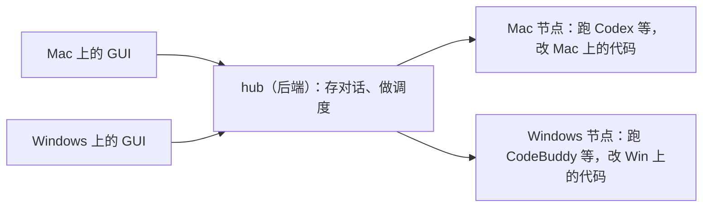
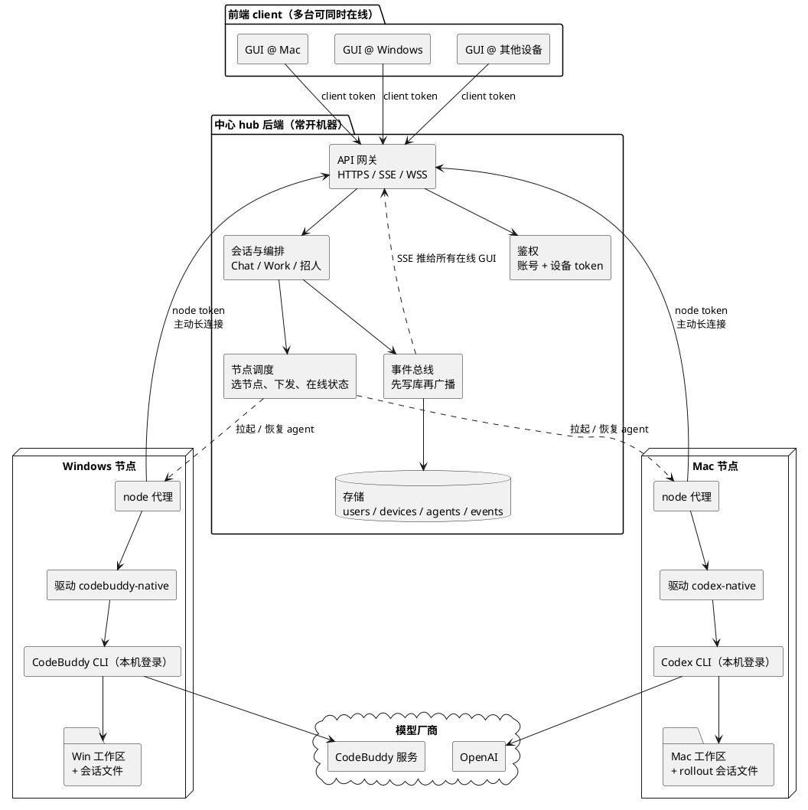
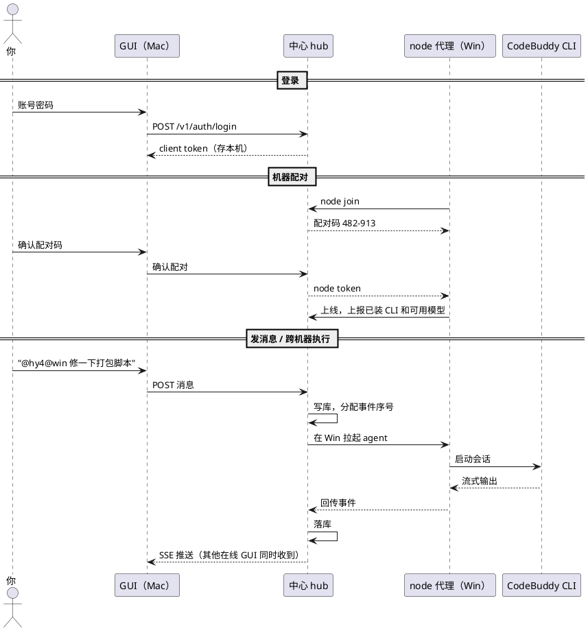
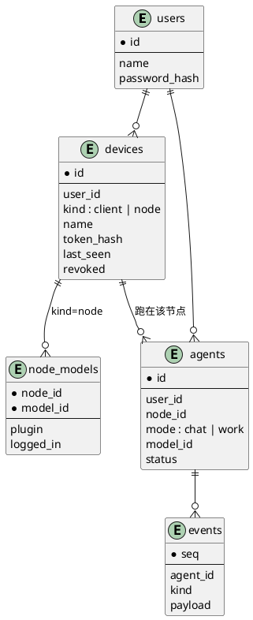

# CrossAgents 多节点设计（草稿）

> 状态：草稿，待打磨。放开 [DESIGN.md](DESIGN.md) §1.2 中「跨主机、多用户、设备配对」这条非目标。
> 标记为「待定」的地方还没有结论，见 §11。

## 0. 产品形态

CrossAgents 是"自己的 ChatGPT 桌面端"：交互像 ChatGPT（侧栏对话列表、Chat / Work 两种模式），背后干活的是你各台机器上的编程 agent（Codex、CodeBuddy、Claude），它们能互相招人协作，并在你自己的代码目录里改代码。任何设备打开 GUI 看到的都是同一份对话和同一组 agent。

| 阶段 | 形态 | 能做什么 |
|---|---|---|
| 现在 | 单机：GUI、hub、agent 都在 Windows | 在 Windows 上用 Chat 和 Work |
| A | 远程 GUI：Windows 当中心，Mac 的 GUI 连过来 | 在 Mac 上操作 Windows 上的对话，agent 仍在 Windows 跑 |
| B | 多节点：每台机器都能跑 agent，hub 统一调度 | 在 Mac 上开发 Windows 项目，跨机器招人 |
| 以后 | hub 迁到常开的云服务器，只当中心 | 任一客户端关机都不影响编排 |

## 1. 目标

- 多台设备看到同一份对话：在 Mac、Windows 或其他设备上打开 GUI，侧栏、转录、实时输出都一样。
- 跨机器执行：在一台机器上操作，让 agent 在另一台机器上跑，例如在 Mac 上开发 Windows 的东西。
- 跨机器协作：一台机器上的 agent 可以招另一台机器上的 agent（`@codex@win`），由中心统一调度。
- 全程托管不因客户端下线而中断：合上笔记本不影响编排和别的机器上的 agent。

### 1.1 非目标（本阶段）

- 跨机器共享文件系统。每个 agent 只碰自己节点的工作区，跨机器交接代码只走 git。
- 跨节点迁移会话。agent 创建后固定在一个节点上（CLI 原生会话文件在那台机器上）。
- 一个 Work run 横跨多个节点。第一版的 run 整体放在一个节点上，跨节点只用于 Chat 里招帮手。
- 多用户注册、团队共享、OAuth 登录。数据结构预留，界面不做。
- 远程代登录 CLI 账号。各节点的 Codex / CodeBuddy / Claude 在本机登录。

## 2. 方案选择

比较过三种拓扑：

| | 固定中心 hub + 节点 | 中心随人走 | 每台都是 hub，互联 |
|---|---|---|---|
| 客户端下线后编排继续 | 是 | 否 | 否（run 归发起机器） |
| 历史只有一份 | 是 | 否，需要搬迁 | 否，分散在各机器 |
| 关机机器的历史可见 | 是 | 否 | 需要缓存副本 |
| 需要常开机器 | 中心一台 | 不需要 | 中转服务需要 |
| 分布式复杂度 | 低 | 高（选主、迁移、冲突） | 中（互联、缓存、中转） |

选固定中心：全程托管要求编排者常在线，而后两种方案为了解决连通和可见性，最终也需要一台常开的服务，不如直接让它当中心。

代价与对策：

- 中心挂了全部不可用。GUI 保留本机模式作为兜底，连不上中心时切回本机 hub 单干。
- 需要一台常开机器。涉及公司代码时放公司内网，不放外部云。

## 3. 总体结构

三层：前端 client（GUI，多台可同时在线）、后端（中心 hub，常开）、执行端（每台机器一个 node 代理）。同一台物理机可以既开 GUI 又跑 node，两者用不同权限的 token。

要点：

- hub 是唯一正本：对话、事件、agent 状态、协作关系都在中心的存储里。
- GUI 是无状态的壳：打开时拉列表和转录，之后靠 SSE 收实时事件。草稿、窗口布局等界面状态留在本地，不同步。
- 节点主动连 hub（反向长连接），不用开端口，不怕 NAT。hub 的指令都走这条连接下发。
- hub 不碰代码。代码和 CLI 原生会话文件留在节点上；hub 只存对话里出现的文本、diff 和命令输出。

## 4. 账号与设备

### 4.1 两层账号

- CrossAgents 账号：由 hub 管，决定你是谁、名下有哪些设备、能看到哪些对话。
- CLI 账号（Codex / CodeBuddy / Claude）：在每个节点本机登录，凭据不离开节点。hub 只知道「这个节点上哪些插件已安装、已登录、能用哪些模型」。
- 同一个 CLI 账号登录在两台机器上，hub 视为两个来源（`codex@mac`、`codex@win`），额度共用。厂商是否限制同时登录设备数未逐家核实（待定），被挤下线时在节点状态里显示。

### 4.2 设备

- 设备分两类：
  - `client`：GUI。可以看对话、发消息、审批、管理设备。
  - `node`：执行端。只能领取分配给自己的 agent、回传事件、上报能力，不能读其他对话。
- 一个账号可以同时有多个设备在线，每个设备各自一个 token，互不影响。
- token 是随机字符串，库里只存哈希，不用 JWT。吊销即时生效：设置里删掉设备，下一次请求就被拒。

### 4.3 登录与配对

- GUI 登录：账号密码 → hub 签发 client token，存在本机（Electron 主进程，渲染层拿不到，沿用 V2 的安全设定）。
- 节点配对：在节点上运行 `crossagents node join <hub 地址>` → 终端显示配对码 → 在已登录的 GUI 里确认 → 节点拿到 node token，之后开机自动连接。
- 第一版只有一个用户：用 `crossagents user add` 建账号，不做注册页和找回密码。以后要接 GitHub、企业微信扫码，只换登录这一层。

## 5. 关键流程

## 6. 多端同时在线

- 看：每条事件先写库、分配全局序号，再推给所有订阅者，各端顺序一致。现有 `/v1/events` 已支持 `since` 与 `Last-Event-ID` 续传，远程 GUI 断线重连沿用即可。
- 发：每个 agent 一个收件队列，多端同时发消息按到达 hub 的顺序处理，沿用现有排队、撤回、`now` 插队。
- 审批：所有在线 GUI 都显示待审批；以先到 hub 的回答为准，其他端变为「已在 <设备名> 上处理」。
- 本地状态：草稿、选中项、窗口布局不同步。

## 7. 节点

### 7.1 职责划分

现有 drivers 拆成两半：

- 留在 hub：选节点、决定拉起 / 恢复 / 挂起、权限规则、事件落库与折叠、协作工具（MCP）的业务逻辑。
- 挪到 node：拉起 CLI 进程、驱动协议翻译（codex app-server、claude stream-json、codebuddy、ACP）、本机账号目录、工作区操作。

hub 与 node 之间是一条双向消息通道（WSS，待定），承载：

- hub → node：`open`、`resume`、`prompt`、`interrupt`、`suspend`、`shutdown`、`set_model`、权限回答、列目录 / 读文件等辅助请求。
- node → hub：统一会话事件（与现有 `Driver` 事件模型一致）、权限请求、能力与模型上报、心跳。

### 7.2 协作工具的接入

agent 的 MCP 现在连本机 hub（`crossagents mcp`，带会话令牌）。跨机器后有两种做法（待定）：

- node 在本机起一个 MCP 端点，转发到 hub。agent 侧配置不变，推荐。
- agent 直连中心 hub 的 MCP。少一跳，但节点上每个会话都要能访问中心地址。

### 7.3 模型与选节点

- 模型 id 带节点名：`codex@mac`、`hy4@win`。`@` 菜单按节点分组。
- 不指定节点时，hub 在已安装、已登录该插件的在线节点里挑：优先发起方所在节点，其次空闲的。
- 节点未安装或未登录的插件不提供模型，招人时跳过（与修 Atlas 时的 `installed()` 规则一致）。

### 7.4 掉线

- 节点掉线：其上 agent 标为「节点离线」；CLI 进程照常跑，事件在节点本地缓存，重连后按序补发。缓存上限与过期处理待定。
- 中心掉线：节点侧同上；GUI 显示连接断开，可切回本机模式。
- 节点重启：hub 下发 `resume`，节点用原生会话 id 恢复。

### 7.5 存储分布与负载

- 对话正本只在中心，不做分片或多副本强一致：个人用量几年也就几 GB，个人机器常休眠，强一致集群反而更容易不可用。
- 附件（截图、构建产物、日志、大 diff）留在节点，hub 只存引用（节点、路径、大小、哈希），GUI 打开时按需拉取；节点离线时附件不可看，文字记录不受影响。
- 节点保留自己 agent 的追加事件日志（离线缓存补发后不删），兼作 hub 灾备重建来源。
- 负载：hub 只做转发和存储，内存几十 MB，CPU 基本空闲；重的是节点上的 CLI 进程（每个几百 MB）和编译测试。每条流式字块一条事件，量大时一轮结束后合并或定期清理。
- 云服务器当纯中心：hub 设内存上限，不在上面跑 agent；附件中转受公网带宽限制。

## 8. 远程开发体验

目标场景：在 Mac 上开发 Windows 的东西。

- 全部在 Windows 上跑：Mac 只当遥控器，agent 与代码都在 Windows，能用 MSVC、Unity、PowerShell、真机调试。默认推荐。
- 两台分工：Mac 上的 agent 写跨平台代码，招 `hy4@win` 拉分支在 Windows 上编译测试，结果回报。代码靠 git 同步。

需要补的能力：

- 远程选目录：目录选择改为向节点请求目录树，而不是 Electron 本机对话框。
- 在 GUI 里看 diff 和文件：不用 pull 也能审查节点上的改动。
- 截图与产物回传：截图、构建产物、日志作为附件在 GUI 里打开。

限制：节点文件不在客户端本地，客户端的 IDE 看不到；界面效果只能看截图或远程桌面；CLI 登录、UAC 等需要本人在场的操作要先在节点上做。

## 9. 数据模型

- 现有表加 `user_id`、`node_id` 两列；`events` 不变。
- 迁移：老数据归到默认用户，`node_id` 指向「本机节点」。
- 招人、可见范围（DESIGN §4.3）都只在同一 `user_id` 内生效。

## 10. 安全

- 跨机器后 hub 不再只监听本机：`[hub] listen` 可配置，默认仍为 `127.0.0.1`，不改配置行为与现在一致。
- 公网或不可信网络必须走 TLS（HTTPS / WSS）。走 Tailscale 或公司内网时，第一版可以只用 token（待定）。
- client 与 node token 权限分离；会话令牌（`/v1/me/*`）仍只发给 agent 自己。
- hub 会存对话里的代码片段、diff、命令输出。放在外部服务器前要确认合规，必要时只存摘要（待定）。

## 11. 待定

1. 中心放哪台机器：这台 Windows 常开，还是另一台 Linux。
2. 连通方式：局域网 / Tailscale / 公司内网，决定第一版是否自己做 TLS。
3. Mac 是只当 GUI，还是也要作为节点跑 agent（影响阶段 B 是否和 A 一起排）。
4. hub ↔ node 的通道用 WSS 还是 gRPC 流，消息格式是否直接复用 `api-types`。
5. 协作工具 MCP 走 node 转发还是直连中心（§7.2）。
6. 节点离线缓存的上限与过期策略。
7. 外部服务器部署时对话是否只存摘要。
8. 同一 CLI 账号多机同时登录的厂商限制。
9. 远程节点、中心 hub 的独立下载包放哪、怎么校验；安装包与 exe 的代码签名（§13.5）。

## 12. 分阶段

| 阶段 | 内容 | 完成标志 |
|---|---|---|
| A1 账号与设备 | `users`、`devices` 表，token 签发 / 吊销，`user add`，`/v1/auth/login` | 本机 GUI 用账号登录本机 hub，设备列表可吊销 |
| A2 远程 GUI | `[hub] listen`，Electron 读连接配置，设置「连接」页（本机 / 远程） | Mac GUI 连上 Windows hub，两端对话一致、断线续传 |
| B1 node 代理 | `crossagents node join`、配对码、hub ↔ node 通道，驱动执行半边挪到 node，本机 hub 也通过内置 node 执行 | Windows hub 在 Mac 节点上拉起 Codex 并回传事件 |
| B2 跨节点 Chat | 带节点名的模型、`@` 分组、跨节点招人、节点离线状态 | Mac 上的 Chat 招 `hy4@win` 并收到结果 |
| B3 远程开发 | 远程选目录、GUI 看 diff 和文件、截图与产物回传 | 在 Mac 上完成一次 Windows 项目的改、编、测 |

A1 不依赖中心放在哪台机器上，可以先开工。B1 的关键是「本机也走 node」：单机模式就是 hub 加一个内置节点，避免维护两套执行路径。

## 13. 升级

目标：发布一个新版本后，谁都不用手敲命令。2026-10-24 修了驱动却没生效，原因是本机跑着的还是旧版 hub；这一节定下各部件由谁、按什么规则升级。设计前提与 §3 一致：GUI 是无状态的壳、hub 可以在远处、每台机器一个 node。不假设 GUI 与 hub 在同一台机器上。

### 13.1 谁升级什么

| 部件 | 谁来升 | 怎么升 |
|---|---|---|
| GUI | GUI 自己 | electron-updater 后台从发布源下载，退出时安装（NSIS，按用户安装，不要管理员）。下次启动即新版 |
| 本机模式的 hub 与内置节点 | 本机 GUI | 安装包里带同版本的 `crossagents.exe`；GUI 启动时复制到 `<home>/bin/<版本>/`，hub 总从这份副本启动。`/v1/info` 的 `version` 比自带的旧 → `hub stop`（agent 留在运行时宿主里）→ 新版 `hub start`，新 hub 接管这些 agent（[PROCESS-SUPERVISION.md](PROCESS-SUPERVISION.md)） |
| 远程节点 | 节点自己 | `join` 或心跳时 hub 回复版本要求（§13.4）；不满足时节点下载新版到自己的 `bin/<版本>/`，用新版重启 node 代理，agent 照样经运行时宿主接管 |
| 中心 hub | 部署它的人 | 云服务器或常开机器上的服务（systemd、Windows 服务、容器）按部署方式升级。GUI 从不升级、不重启远程 hub，版本不匹配时只显示说明页 |

本机模式就是「hub + 内置节点」（§12 B1）：两者同一个 exe、同一个版本，一起换，所以本机永远不会出现 hub 与内置节点版本不一致。

### 13.2 为什么按版本分目录

`runtime-host` 和 `mcp` 子进程都从 `current_exe()` 拉起（[paths.rs](../crates/hub/src/paths.rs)、[lib.rs](../crates/hub/src/lib.rs) `default_mcp_command`），而宿主比 hub 活得久。只要还有 agent 在跑，那份 exe 就被占用：Windows 上删不掉、也覆盖不了。如果 hub 直接从安装目录跑，GUI 自动更新时就替换不了安装目录里的 exe。

所以：

- 安装目录里的 exe 只当「安装源」，从不直接运行（除了查 `--version`）。
- 每个版本一个目录 `<home>/bin/<版本>/crossagents.exe`。目录已存在且内容一致（sha256）就不再复制；先写 `.partial` 再改名，半截文件不会被当成可用版本。
- 新 hub 起来后，清理其他版本目录：当前版本、正在跑的 hub 所在目录不动；其余目录只有在没有进程从它运行时才删。Windows 上用「试着删 exe」判断（运行中的映像删不掉），其他系统查 `ps` 的命令行。被接管的旧宿主（以及它的 `mcp` 子进程）还在跑时，旧目录留到下次启动再试。
- 被接管的 agent 继续用旧目录里的 `mcp`；它下次被 hub 重新拉起或恢复时，用的是新 hub 的命令，旧目录随之空出来。

### 13.3 怎么判断是「本机自己的 hub」

只有安装版 GUI（`app.isPackaged`）才管理 hub；`npm run electron:dev` 保持原样，只连现有的 hub。

判断依据只有一条：`hub.json` 里的 `exe`（hub 启动时写入的 `current_exe()`）位于 `<home>/bin/` 之下。

| 情况 | GUI 怎么做 |
|---|---|
| 没有 hub 在答 `/v1/info` | 用自带版本 `hub start` |
| 自己的 hub，版本相同 | 不动 |
| 自己的 hub，版本比自带的旧 | `hub stop` → 新版 `hub start`，agent 被接管 |
| 自己的 hub，版本比自带的新（GUI 被降级了） | 不降级 hub，等 GUI 自己更新；`api` 不同则照常显示说明页 |
| 外来的 hub：手动从 `target/debug` 启动、旧版 hub 的 `hub.json` 没有 `exe`、以后的远程 hub | 从不停、不重启，沿用 [API-AUTH.md](API-AUTH.md) §5 的比对与说明页 |

两个 GUI 同时启动会争着起 hub、换 hub，所以安装版 GUI 单实例运行，第二次打开只是把已有窗口提到前面。

A2 之后 GUI 可以连远程 hub：连接配置是远程时，这整套本机管理关闭，GUI 只当客户端；从远程切回本机时再按上表检查一次。

### 13.4 hub 与 node 的版本规则

与 GUI↔hub 的 `API_VERSION`（[API-AUTH.md](API-AUTH.md) §5）平行，hub↔node 通道另有一个协议版本 `NODE_PROTOCOL`（放在 `api-types`，与 `API_VERSION` 分开升）：

- 升版条件与 §5 相同，作用对象换成 hub↔node 的消息：删改字段或消息类型、改语义或单位、新增必填字段、收紧校验算破坏性变更，必须升；新增可选字段、新消息类型、新枚举取值不升，前提是双方忽略不认识的取值。
- node 在 `join` 和每次心跳里带上 `protocol`（`NODE_PROTOCOL`）、`version`（构建版本）和能力列表。
- `protocol` 不在 hub 支持的范围内 → hub 拒绝该节点上线（不分配、不恢复 agent），回复支持的范围和下载地址。节点比 hub 旧就自升级；节点比 hub 新就不降级，标「等待 hub 升级」，与 GUI 不降级 hub 同理。不静默降级。
- `protocol` 相同、`version` 不同 → 允许上线；hub 记下节点版本，在节点列表标出。依赖新功能的指令按节点上报的能力判断，不按版本号猜。
- 先升 hub、后升节点：hub 至少同时支持 `NODE_PROTOCOL` 的当前版和上一版，跨一个发布周期，让离线的节点回来后还能连上并收到升级要求。
- 节点自升级的步骤：下载新版并校验 sha256 → 放进 `bin/<版本>/` → 用新版起 node 代理 → 旧代理断开通道并退出 → 新代理按运行时宿主的握手接管 agent → 旧目录无进程使用后清理（§13.2）。升级期间 agent 不停，事件在宿主里缓存，重连后按序补发（§7.4）。
- 本机模式下 hub 与内置节点是同一个 exe，天然同版本，不走这套协商。

### 13.5 发布

- 一次发布 = GUI 安装包 + 同版本的 `crossagents.exe`。Cargo workspace 版本与 `apps/gui/package.json` 必须相同，打包前由 `apps/gui/scripts/check-version.mjs` 检查。GUI 的版本号决定 electron-updater 是否更新，exe 的版本号决定 `bin/` 下的目录名和是否替换 hub。
- 发布源：GitHub Releases，放在公开仓库 `L1nkkkk/CrossAgents-releases`。主仓库是私有的，electron-updater 读私有仓库的 Release 要把 GitHub token 打进每个安装包，等于公开了它。`npm run electron:build` 只打包；`npm run electron:release` 打包并上传（需要 `GH_TOKEN`）。
- 远程节点和中心 hub 用的单独可执行文件（`crossagents-<os>-<arch>` 加 sha256），以后附在同一个 Release 里，节点自升级从这里取（待定）。
- 安装包未签名：Windows SmartScreen 首次运行会提示。签名证书待定。
