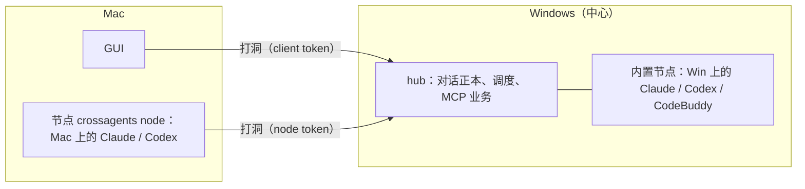

# B1 任务书：节点（每台机器的 CLI 在本机跑，hub 汇总）

> 依据：[MULTI-NODE.md](../MULTI-NODE.md) §0、§3、§7、§11、§12「B1」、§15 · 相关：[PROCESS-SUPERVISION.md](../PROCESS-SUPERVISION.md)、[MACOS.md](MACOS.md) §4 ·
> 来源：2026-11-12 对话（人：「每个机器的 cli 跟着 gui 走，hub 来汇总」）· 状态：§3 与 §9 的选择人已确认（2026-11-12，按推荐）· **B1.1、B1.2 已完成（2026-11-12）**：B1.1 提交 `936df53`…`c2a6556`，B1.2 提交 `cf79447`…`117e367`（run 分支 `crossagents/c3cec636`）。真实冒烟（2026-11-12，`builtin_node` 默认 true，独立 home，Claude haiku 与 Codex gpt-5.6-luna）：**Claude 通过**，**Codex 通过**——各自开会话、一轮对话、运行中 steer（两边都读到并回应）、interrupt（turn 以 cancelled 结束）、hub 在一轮进行中停掉再起，两边 adopt 接回并跑完该轮，重启后再对话一轮，且都记得重启前的内容。未跑 `builtin_node = false` 对照。

## 1. 要做成什么样

- 每台要跑 agent 的机器有一个**节点**：用本机的 CLI、本机的登录、本机的代码目录拉起 agent，把会话事件回传中心。
- 中心 hub 只做调度和汇总：对话、agent、用量都在它那里，任何 GUI 看到的都一样。
- 新建 agent 时选它在哪个节点上；agent 建好后固定在那个节点（CLI 原生会话文件在那台机器上，§1.1）。
- 界面上不再有指代不清的「本机」：账号、CLI、项目目录、用量都标明是哪个节点的。

完成标志（MULTI-NODE §12）：**Windows 的 hub 在 Mac 节点上拉起 Codex（或 Claude），Mac 和 Windows 的 GUI 里都能和它对话、看到实时输出；Mac 节点断网再连上，没丢事件。**

## 2. 不做（留给后面）

- Work run 跑在远程节点上。B1 的 run 仍整体在中心机器上（§1.1「一个 Work run 横跨多个节点」也不做）；远程节点只跑 Chat 里的 agent。
- 跨节点招人的界面（`codex@mac`、`@` 菜单分组）：B2。B1 只让 `agent_spawn` 和 GUI 能指定节点。
- 远程选目录、看远程 diff 和文件、截图回传：B3。B1 里远程节点的目录手填。
- 中心掉线时节点单干：C。
- A3 开端口直连。节点只走打洞（§3）。

## 3. 已定与建议定下的选择

MULTI-NODE §11 有三条和 B1 直接相关，2026-11-12 人确认按下表定：

| §11 | 建议 | 理由 |
|---|---|---|
| 第 10 条：节点怎么连中心 | **已定：走打洞**（`crates/link`），node 用 `kind = node` 的设备 token | 已经在 Mac 上跑通；不开端口、不要证书；A1 已为 node 预留 kind（[access.rs](../../crates/hub/src/access.rs) 里 node token 到不了现有路由） |
| 第 4 条：通道格式 | **已定：一条 QUIC 流上的 JSON 行**，消息体直接用 `core` 里已经 `Serialize` 的类型（`SessionEvent`、`Agent`、`PermissionRequest` 等） | 和 runtime host 的 [wire.rs](../../crates/drivers/src/host/wire.rs) 同一种做法（带 `seq` 和 `ack`，重连补发），已经被进程监督验证过；不引入 gRPC |
| 第 5 条：MCP | **已定：节点转发**：节点把中心 hub 的 API 端口经打洞转到自己的 `127.0.0.1`，agent 的 `crossagents mcp` 连这个端口 | agent 侧配置不变（MCP 仍是本机 stdio 进程）；会话 token 照旧由 hub 发、hub 验 |

### 3.1 切在哪里：`Driver` trait

hub 现在通过 [`Driver` / `DriverSession`](../../crates/core/src/driver.rs) 用驱动：`open`、`resume`、`adopt`、`prompt`、`steer`、`interrupt`、`suspend`、`set_model`、`compact`、`shutdown` 等。
驱动内部碰本机的地方很多：找 CLI（`locate.rs`）、读写 CLI 的配置目录（`mcp_config.rs`、`codex_native` 的 `models_cache.json`、`codebuddy_native` 复制插件）、读附件文件、runtime host。所以**整个驱动搬到节点上跑**，中心这边换成一个 `RemoteDriver`，实现同一个 trait，把每个调用变成通道上的一条消息。runtime.rs 等上层代码基本不用改。

**本机也走节点**（MULTI-NODE §12：「B1 的关键是本机也走 node」）：节点的逻辑写成一个与传输无关的 `NodeService`。远程节点经打洞连它，中心自己的内置节点经内存里的通道连它。这样只有一条执行路径，内置节点的测试就覆盖了远程节点的大部分代码。

## 4. 通道协议

一个节点对中心保持**一条控制流**（打洞连接上的一个 QUIC 双向流），JSON 行。另外按需开 API 转发流（§3 第 5 条，就是现有的 `tunnel`）。

开头：`Hello::Node { token }`（[link lib.rs](../../crates/link/src/lib.rs) 的 `Hello` 加一种），中心验过是 node 设备后回 `Reply { ok }`，此后两边按下面的消息说话。

| 方向 | 消息 | 说明 |
|---|---|---|
| node → hub | `Register { node_version, os, hostname, plugins }` | 每次连上先发。`plugins`：每个插件是否已装、CLI 路径与版本（`CliStatus`）、模型与 effort、能力表 |
| hub → node | `Call { id, op }` | `op` 对应 `Driver` / `DriverSession` 的方法：`open{agent_key, spec}`、`resume`、`adopt`、`prompt`、`steer`、`interrupt`、`suspend`、`fork`、`rollback`、`set_model`、`compact`、`shutdown`，以及 `probe_cli`、`refresh_cli`、`install_cli` |
| node → hub | `Return { id, result }` | `Call` 的结果；`prompt` 的 `TurnOutcome` 在轮次结束时才回 |
| node → hub | `Event { seq, session, event }` | `SessionEvent` 原样；`seq` 按节点单调递增 |
| hub → node | `Ack { seq }` | 中心落库后确认；节点删掉 `seq` 及以前的缓存 |
| node → hub | `Ask { id, session, request }` | 需要权限回调的驱动（`permission_callback`）问中心；中心跑 `Guard` 后回 `Answer { id, decision }` |
| 双向 | `Ping` / `Pong` | 15 秒一次，45 秒没收到算掉线 |

**`SessionSpec` 怎么过线**：`agent`、`mcp_servers`、`permission`、`command`、`instructions`、`env` 都能序列化；`events`（mpsc 发送端）在节点侧新建，事件经 `Event` 回传；`permissions`（回调）变成一个布尔，节点侧用一个发 `Ask` 的 `PermissionHandler` 代替。
`mcp_servers` 里 `crossagents` 那一项的 `URL_ENV` 由**节点**改写成自己转发出来的本地端口，`program` 改成节点自己的 `crossagents` 程序（[collab.rs](../../crates/hub/src/collab.rs) `SessionExtras`）。

**掉线与补发**：节点按 `seq` 缓存未确认的 `Event`，重连后 `Register` 之后先补发；中心按 `(node, seq)` 去重。agent 进程在节点上照常跑（节点里仍用 runtime host，见 PROCESS-SUPERVISION），掉线期间正在跑的 `prompt` 由中心标为「节点离线」，重连后用 `adopt` 接回（与 hub 重启时的接管同一套）。缓存上限 B1 先定为 10 万条或 200 MB、7 天，超了丢最旧的并发一条 `Warning`（§11 第 6 条，人可改）。

**版本**：`Register.node_version` 与 hub 版本主次号不同时，中心拒绝并让 GUI 显示「这台机器的节点要升级」（MULTI-NODE §13.4）。

## 5. 数据与接口

- `agents` 加 `node`（节点设备 id；空 = 中心的内置节点）。旧数据不用迁移：都是空。
- 节点：就是 `devices` 里 `kind = node` 的那些，加上内置节点（固定 id `local`，名字是中心的 hostname）。`GET /v1/nodes`（read）返回每个节点的名字、系统、在线状态、最后在线、版本、插件清单。
- `GET /v1/plugins` 加 `?node=`；模型列表、CLI 状态、安装 CLI 都按节点。
- 账号：`accounts` 加 `node`。hub 启动时自动加的「本机 X 登录」改成节点注册时由节点上报（`Register` 里带上它找到的登录目录），名字改为「X 登录」，界面在旁边标节点名。迁移：已有的 `本机 X 登录` 改名为 `X 登录`、`node = local`（[accounts.rs:134](../../crates/hub/src/accounts.rs)、[account_import.rs:350](../../crates/hub/src/account_import.rs)）。
- 用量：`usage` 已经能按 agent 归，加一个按节点的维度（经 agent 的 `node`）。说明文字里的「this machine's local time zone」改为「中心的时区」，并翻成中文（[usage_series.rs:197](../../crates/hub/src/usage_series.rs)）。
- 项目：`ProjectPathInfo` 已经是按 `node` 记的检出路径，远程节点上的 agent 用那个节点的路径。
- 内置终端：`TerminalInfo.node` / `CreateTerminalRequest.node` 已预留；B1 里放开，在节点上开 PTY（经控制流的 `Call` 开、数据走单独的流）。这一项排在最后，可单独验收。

## 6. 程序与安装

- `crossagents node run`：节点进程。读 `<home>/node.json`（中心的 endpoint、relay、node token），连中心，跑 `NodeService`。
- `crossagents node join`：从 stdin 读配对码，用 `Hello::Redeem` 换一个 `kind = node` 的设备（`Redeem` 加 `kind` 字段），写 `node.json`。中心的「设备」页「生成配对码」加一个选项：给 GUI 还是给节点。
- Mac 安装包：现在只带 `crossagents-link`，要加上 `crossagents`（node 模式用）；GUI 的 [localHub.cts](../../apps/gui/electron/localHub.cts) 从「管本机 hub」扩成「管本机 hub 或本机节点」（MULTI-NODE §7.1 第三条）。Mac 上 GUI 配对中心时一并问「这台也当节点吗」，是就再换一个 node token 并拉起节点。
- 节点在 macOS 上用登录 shell 取一次环境（`$SHELL -ilc env`，5 秒超时），不然 launchd 起的进程找不到 `claude`、`codex`（[MACOS.md](MACOS.md) §4）。
- `.github/workflows/mac.yml` 的打包步骤加编 `crossagents-cli`，包里检查也加上它。

## 7. 界面

- 新建 agent / 编辑 agent：加「运行在」下拉（节点名 + 在线点），默认中心的内置节点；不在线的灰显。模型下拉按所选节点的插件清单。
- 侧栏的 agent 行：不在中心机器上的，名字后面标节点名（小字）；节点离线时 agent 头像灰显、状态写「节点离线」。
- 设置 →「设备」：节点单独一组，显示在线、版本、插件；可吊销。
- 「用量」：订阅与额度按节点分组；来源筛选加节点。
- 去掉所有指中心却写「本机」的文案，改为节点名：[Quota.tsx](../../apps/gui/src/views/Quota.tsx) 56、565-577 行，[Agents.tsx](../../apps/gui/src/views/Agents.tsx) 282、849、856 行，[Projects.tsx](../../apps/gui/src/views/Lessons/Projects.tsx) 89 行。「本机」只留给「GUI 所在的这台电脑」本身（连接页、打开文件的副本）。
- 顺手核对远程模式下在客户端执行的操作：终端、内置浏览器、通知（选文件夹和打开文件已处理，[main.cts](../../apps/gui/electron/main.cts) 396、503 行附近）。

## 8. 分步

每步单独可验收、可合入；前一步不依赖后一步。

| 步 | 内容 | 验收 |
|---|---|---|
| B1.1 协议与 `NodeService` | 新 crate `crates/node`：消息类型、`NodeService`（拿驱动表跑 `Call`、发 `Event`、缓存与补发）、内存传输；`RemoteDriver` 在 hub 侧实现 `Driver` | 单测：用 `mock-agent` 经内存通道 `open` → `prompt` → 事件到达 → `shutdown`；中途断开再连，事件不丢不重 |
| B1.2 内置节点 | hub 的驱动表全部换成「`RemoteDriver` + 内存通道 + 内置 `NodeService`」；`agents.node` 列 | 现有测试全过（`cargo test --workspace`），行为不变；GUI 冒烟：Chat 和一个小 Work 照常 |
| B1.3 打洞上的节点 | `Hello::Node`、`Redeem.kind`；`crossagents node join` / `node run`；`GET /v1/nodes`；MCP 经节点转发 | 两个进程在同一台 Windows 上：节点经 n0 中继连中心，在节点上开一个 mock agent，它调 `agent_send` 成功；杀掉节点进程再起，`adopt` 接回 |
| B1.4 节点上报与按节点的数据 | `Register.plugins`、账号按节点、`/v1/plugins?node=`、用量按节点、改名迁移 | `crossagents agent add … --node <名>` 能建在远程节点上；`account ls` 标节点；旧库升级后「本机 Claude 登录」变「Claude 登录 · <中心名>」 |
| B1.5 界面 | §7 全部 | mock 预览里有节点场景；真 Electron 里能在 Mac 节点上建 agent 并对话 |
| B1.6 Mac 节点 | Mac 包带 `crossagents`、GUI 管本机节点、登录 shell 取环境、CI 打包检查 | **人在 Mac 上实测完成标志（§1）** |
| B1.7 节点上的终端 | §5 最后一条 | 在 Windows 的 GUI 里开 Mac 节点上的 zsh |

估计：B1.1–B1.3 是核心，B1.2 风险最大（所有现有会话改走新路径）。建议 B1.1 和 B1.2 一个 Work，强模型规划、合并前跑全量测试和一次真实 Codex / Claude 冒烟。

## 9. 风险与待人定

- **B1.2 动了所有会话的路径。** 内存通道必须零语义差别；先做一个开关（`[hub] builtin_node = true`），出问题能切回直接调驱动，稳定一个版本后删掉开关。
- **权限回调变成跨机器往返。** `Ask` 慢了会拖住 agent；超时（60 秒）按 `PermissionPolicy` 的默认处理，并发一条 `Warning`。
- **同一个 CLI 账号多机同时登录**（§11 第 8 条）：B1 不处理，各机器各自登录，界面只标出来。
- **离线缓存上限**（§4）的数字，人可改。
- **已确认（2026-11-12）**：§3 的三个选择；B1 不含远程 Work run；B1.7 节点上的终端留在 B1，排最后一步。
