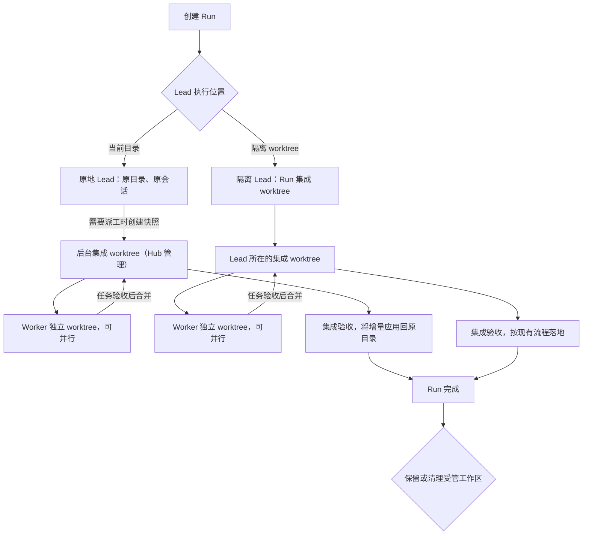

# LEAD 任务书：Lead 执行模式与工作区保留

> 依据：2026-10-29 讨论（修个小 bug 也要建 worktree、主导搬家丢上下文、再冷编译一遍 target；run 一结束主导被送回、检出被删，没法接着干）· 状态：方向已定，未开工 · 与 [G1.md](G1.md)（工作组）合并实施，衔接见 §9

## 1. 目标与边界

让人接着原来的对话和代码继续工作，同时保留多 Worker 并行、隔离和验收能力。

- Lead 可以选择原地执行或 worktree 执行。
- 并行 Worker 始终使用各自独立的 worktree，与 Lead 在哪里无关。
- Run 完成、Lead 会话结束、工作区清理是三个独立动作。
- 保留原会话和稳定的执行环境，减少上下文重建和重复编译。

不做：Worker 在用户目录里干活；原地模式自动提交、自动回滚；承诺模型缓存命中率。

## 2. 人要选什么

创建 Run（G1 之后是创建工作组）时两个独立选项：

| 选项 | 可选值 | 默认 | 含义 |
|---|---|---|---|
| Lead 执行位置 | 当前目录 / 隔离 worktree | 隔离 worktree | Lead 是否搬家 |
| 完成后的工作区处理 | 保留 / 清理 | 保留 | 受管工作区是否继续保留 |

原地模式中的用户目录永远不属于自动清理对象。由人显式选择，不让主导按任务大小自己判断。

## 3. 两种模式的结构

原地模式下的后台集成 worktree 不开 Lead 会话，只是 Hub 汇总代码和跑检查的地方。Lead 不派 Worker 时直接在当前目录修改和验收，不建后台集成 worktree。（是否保留后台集成 worktree 见 §10 第 1 条。）

## 4. Lead 的行为

原地模式：

- 用原 Agent、原会话、原目录，不因创建 Run 而复制替身或重建对话。
- 不切换人当前的分支；允许工作区已有未提交修改。
- Hub 不自动提交用户目录里的修改。
- Lead 可以直接干，也可以派 Worker。

worktree 模式：

- Lead 在 Run 集成 worktree 中工作。
- 驱动支持迁移就延续原会话（现有 `lead_in` → `place`）；不支持时明确提示需要新会话，不宣称保留完整上下文。
- 保留该 worktree 和会话，就能在这里继续工作。

## 5. Worker 如何取得代码

Worker 必须从明确、固定的版本开始，不能按原目录的 `HEAD` 建 worktree，否则漏掉 Lead 没提交的修改。

原地 Lead 首次派工：

1. 捕获当前工作区快照。
2. 用快照初始化后台集成 worktree。
3. 从集成版本建 Worker 的分支和 worktree。
4. 记录每个任务的实际起点。

快照：独立临时 index（`GIT_INDEX_FILE`）+ 专用 Git ref（如 `refs/crossagents/snapshots/<run>/<n>`），不改人的暂存区、当前分支和 stash 列表。默认覆盖受跟踪文件和未被忽略的新文件；忽略文件、子模块内部修改单独定义支持范围。专用 ref 永不推送；设单文件大小上限，快照里出现疑似密钥文件（`.env`、`*.pem` 等）时提示人。

后续 Worker 默认从最新已接受的集成版本开始。Lead 原目录的新修改不会自动混进去，需要显式同步成新的集成版本；已在跑的 Worker 保持原基线，必要时再同步。

## 6. Worker 结果如何回来

沿用现有任务验收：完成修改 → 记录待验收提交 → `Verifying` 跑检查 → 接受 → 合并到集成工作区。多个 Worker 的结果在集成工作区串行合并，并跑整体验收；单个 Worker 通过不代表组合后通过。

原地模式增加“应用回当前目录”：

- 只应用 Worker 相对起始快照的增量。
- 对比派工快照、集成结果、用户目录当前内容三方，处理期间发生的修改。
- 有冲突就停止应用并展示冲突，不覆盖人的修改。
- 全部文件先算完合并、确认无冲突再统一写入，不留半应用状态；应用前确认目录未变化；记录应用状态，支持中断恢复、防止重复应用。
- 保留人原有暂存状态，带回的修改默认不提交。
- Windows 上按 Git 的换行与过滤器规则写回（`autocrlf`、`.gitattributes`），不能整文件翻换行；删除、重命名、二进制、可执行位都要覆盖。
- 原目录有额外修改时重新跑相应检查，不沿用集成目录的通过结果。

应用回来之前，Lead 在原目录读文件看不到这些修改。Hub 必须提供集成 diff、检查结果，以及在集成目录执行检查的明确入口。

## 7. 并行与验收约束

Worker 目录彼此独立，可以并行。需要串行的是对同一目录的写入：

- 同一 checkout 同时只允许一个 Run 持有原地写入占用（按规范化路径记，与 G1“一组一个未结束 run”是两层不同的锁）。
- Lead 写入、应用 Worker 结果、最终验收不交叉。Hub 拦不住 Lead shell 里的每次写文件，做法是按轮次控制：Lead 本轮结束后才开始应用；应用和检查期间暂缓投递会唤醒 Lead 的消息。
- 其他 Run 向这个目录落地也必须遵守同一占用（`landing.rs`、`check_checkout`）。
- 取消任务后确认受管进程停止写入，再释放占用。Run 完成时释放占用，否则人回原目录会被已结束的 Run 挡住。
- 沿用 `Verifying`：检查可后台执行，检查期间保留占用。
- 未提交内容的验收结果绑定内容快照，接受或结束时内容变了就要求重验。Hub 拦不住外部编辑器，共享目录的验收需要人配合，不承诺与独立环境同等的隔离。

## 8. Run 完成后如何继续

Run 完成只结束这一轮任务和调度，不自动终止 Lead 会话。

选择保留时：

- 保留 Lead 会话、工作目录和相关构建缓存（`<run>/targets/integration`）。
- 释放已结束 Run 的任务占用和目录占用。
- 人可以继续讨论、看代码，或开下一轮（G1 `run_next`）。下一轮可复用保留的工作区，但重新记录起点和任务归属，不重开旧 Run。
- 保留的集成工作区可能已落后于目标分支，下一轮开始前展示差异，必要时同步并重验；不强制重建会话。

Worker 临时工作区单独管理：结果已合并、进程已停、没有待保留修改，任务接受后即可清理，不跟随 Lead 保留。

### 清理与失败

清理按工作区归属执行，不能只看路径或一个 `in_place` 字段。清理前检查：是否仍有 Agent 或进程在用；是否有未提交、未汇总、未落地的修改；必要的提交、快照和恢复信息是否已保留。有未保存的结果就保留现场并提示。

原地任务取消或失败：停止受管执行；保留修改和检查报告；不自动 reset、checkout 或删除人的文件；后续任务不能默认忽略失败任务留下的修改，需要明确选择修复或接受现状。

## 9. 与 G1（工作组）的衔接

G1 管“同一对话里一轮接一轮”，本方案管“Lead 在哪、工作区留不留”，两者在下面几处直接冲突，以本节为准：

| G1 原文 | 冲突 | 改为 |
|---|---|---|
| §3.4 每轮把主导 `place` 进新一轮的集成工作区，结束后 `send_home`，“和现在一样” | 本方案要求完成后保留 Lead 工作区和会话 | worktree 模式：本轮结束不 `send_home`；同组下一轮叠在上一轮分支上时，在同一个集成 worktree 里切到新 run 分支，Lead 不搬家、`targets/` 复用。`from: "base"` 或上一轮已落地时，在同一 worktree 里同步到基线后再切分支，仍不搬家。原地模式：Lead 始终在原目录 |
| §3.3 分支规则表 | 只适用于有 run 分支的 worktree 模式 | 原地模式没有 run 分支：下一轮以当时目录的新快照为起点，不存在“连带落地” |
| §3.1 一组一个未结束 run | 不能代替目录占用 | 两者都要：组内一轮、按 checkout 一个原地写入者 |
| 完成后保留 / 清理 | 按 run 选的话，组内每轮都要选一次 | 作为工作组的设置，每轮继承（见 §10 第 3 条） |

现有代码里要一起改的收尾路径：`engine.rs::finish_run`（`let_go_run` + `remove_integration`）、`checkout_vacated`、`landing.rs::lead_left` / `lead_returned` / `runs_lived_in`、`delete.rs`。

## 10. 待定

1. 原地模式是否需要后台集成 worktree。另一种做法：每次派工对原目录拍快照，接受任务时把 Worker 增量直接三方合并进原目录并在原目录验收，只有一份集成版本，省掉“显式同步”和二次检查；代价是 Worker 之间的合并改为文件级三方合并、不产生 merge commit。P3 开工前定。
2. 原地模式下，Hub 的“任务验收后合并”是否要求人当场在原目录看到结果（每个任务应用一次），还是 Run 结束时一次应用。
3. 完成后保留 / 清理是工作组级设置还是每轮可改。倾向工作组级。
4. 非 Git 目录无法快照：非 Git 原地 Run 只支持 Lead 自己干，不能派 Worker。

## 11. 数据与代码

现有 `run.in_place` 同时表示“非 Git”“不建 worktree”“串行”，不能再用它表示 Lead 的位置。拆成（字段名实现时定）：

| 概念 | 用途 |
|---|---|
| Lead 执行模式 | 原地 / worktree |
| 工作区版本控制能力 | Git / 非 Git |
| 工作区归属 | 用户目录 / Hub 管理 |
| 完成后的保留策略 | 保留 / 清理 |
| 集成工作区位置 | 与 Lead 当前目录分开 |
| Run、Task、验收快照 | 起点、增量、验收对象 |
| 目录占用与应用记录 | 控制并发、恢复中断 |

主要改动：创建 Run 时原地 Lead 直接 `claim`，不走 `lead_in`；派工以快照代替对用户目录的自动提交；`ws_for` 按实际操作对象选 provider，不再整个 Run 二选一；保留 Worker 提交验收，新增向原目录应用增量；拆开 Run 完成、Lead 释放、工作区删除；界面与提示词写明 Lead 当前目录、集成目录、结果是否已应用。旧数据：旧 Git Run 保持原语义；旧非 Git 原地 Run 保持串行。

上下文与缓存：两种模式都靠继续原会话延续上下文；原地模式少了因搬目录而复制替身的情况；Worker 新会话不继承 Lead 的上下文。不承诺命中率，收益用缓存 token 和耗时统计验证。

## 12. 分阶段与验收

| 阶段 | 内容 | 验收 |
|---|---|---|
| P1 | 拆分收工与清理：`finish_run` 不再 `let_go` Lead、不删集成 worktree；保留 / 清理策略；单独的清理入口；与 G1-2 同时做（§9） | Run 完成后 worktree 和原会话仍可用；同组下一轮不搬家、复用 `targets/integration`；选清理时行为与现在一致；重启 Hub 不误删 |
| P2 | Lead 原地：拆分模式字段；原地 Lead 直接认领；目录占用；Lead 自己修改的原地验收（内容快照绑定）。不实现“Worker 在用户目录串行干活” | 原地开启 Run 后 Lead 的会话和目录不变；不切分支、不提交、不动暂存区；验收后内容变了旧结果不能当通过凭据；同一 checkout 第二个原地 Run 被拒 |
| P3 | 混合派工：快照、后台集成（或 §10 第 1 条的替代做法）、多 Worker 并行、应用回原目录 | 两个 Worker 并行；Worker 拿得到派工时已有的未提交修改；快照和 diff 不改暂存区；Lead 后续修改与 Worker 结果冲突时不覆盖、不误提交；重复接受、应用中断、Hub 重启不重复落地、不误删用户目录 |
